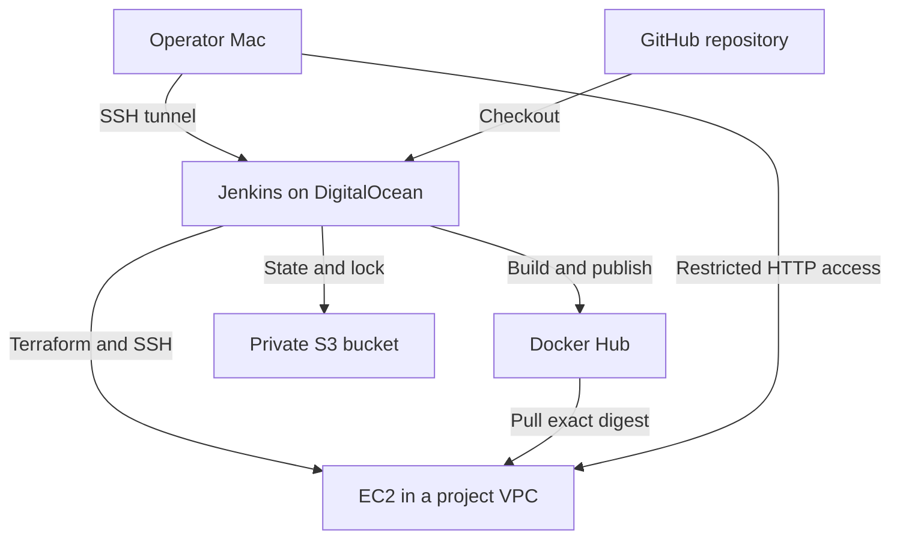

# Complete CI/CD with Terraform

A Jenkins pipeline that builds a Spring Boot application, verifies an AMD64 Docker image, publishes it to Docker Hub, provisions an AWS EC2 server with Terraform, and deploys the exact published image digest with SSH and Docker Compose.

**Verified on October 11, 2026 (America/Vancouver):** initial deployment and repeat deployment both succeeded. The first run created 14 AWS resources; the second made no infrastructure changes and deployed a new image on the same instance.

## Architecture



Jenkins runs on a fresh Ubuntu Droplet, with its web port bound to `127.0.0.1:8080` and accessed through an SSH tunnel. The application runs as UID/GID `10001:10001` on Amazon Linux 2023 in `ca-central-1`. EC2 security rules allow SSH and HTTP only from approved IPv4 CIDRs.

## Pipeline

1. Check out the configured branch and derive a commit/build image tag.
2. Check Java, Maven, Docker, and Compose.
3. Package the application using `mvn clean verify`.
4. Build and assert a `linux/amd64` image.
5. Verify the homepage in an isolated Compose deployment, probing inside the application container.
6. Authenticate to Docker Hub, push the image, and record its digest.
7. Initialize the locked Terraform provider and S3 backend; reject deletion/replacement before applying the saved plan.
8. Obtain the EC2 SSH host key through authenticated AWS console output, wait for bootstrap readiness, transfer deployment files, and deploy by digest.
9. Compare the EC2 homepage byte for byte with the source HTML, archive the JAR/digest, and clean up build image tags.

No Jenkins shared library is required. This project does not provision EKS, ECR, a database, or an Ansible environment.

## Verified results

| Evidence | Build #1 | Build #2 |
|---|---|---|
| Jenkins result | `SUCCESS` | `SUCCESS` |
| Application commit | `ec97d3ef64fb336db647cf51a781f3bc94be76c1` | Same commit |
| Terraform apply | 14 added, 0 changed, 0 destroyed | 0 added, 0 changed, 0 destroyed |
| EC2 instance | `i-063e9387fb8155c11` | Same instance |
| Docker Hub tag | `ci-ec97d3ef64fb-1` | `ci-ec97d3ef64fb-2` |
| Application deployment | New container | Container recreated for new digest |
| Homepage comparison | Passed in Jenkins and from Mac | Passed in Jenkins |

Historical application address: `http://3.99.49.109:8080/`. It is restricted to approved IPs and may be unavailable after teardown; it is not a public portfolio endpoint. Obtain the current address from Terraform outputs.

Build #2 deployed:

```text
younghadiz/complete-cicd-with-terraform@sha256:fc90198a427321a723843b967365715789ef3287db230a0476b6a2b20d6006aa
```

Maven reported **no tests to run**. Validation includes builds, Bash syntax checks, Terraform validation, HTTP smoke checks, and end-to-end deployments. Six offline host-key parser checks were also run during implementation, but were not committed as a test suite.

## Repository

| Path | Purpose |
|---|---|
| `Jenkinsfile` | Complete pipeline, credentials, plan guard, SSH deployment |
| `pom.xml`, `src/` | Application and static homepage |
| `Dockerfile`, `.dockerignore` | Application image and build context |
| `docker-compose.yaml`, `server-cmds.sh` | Deployment and readiness verification |
| `terraform/` | VPC, network, key, rules, EC2, bootstrap, outputs |
| `bootstrap/backend/` | Separate root provisioning the protected S3 bucket |
| `iam/jenkins-terraform-policy.json` | Dedicated Jenkins IAM policy |
| `scripts/ec2_known_hosts.py` | Instance/address verification and host-key extraction |
| `infrastructure/jenkins/` | Official-image-based controller build and localhost-only startup |
| `SOURCES.md` | Attribution |
| `docs/RUNBOOK.md` | Standalone guide and complete 36-file source appendix |

Primary: [GitHub](https://github.com/younghadiz/complete-cicd-with-terraform). Mirror: [GitLab](https://gitlab.com/devops-engineering-projects/complete-cicd-with-terraform).

The verified job uses `feature/terraform-cicd`. These documents were prepared from commit `b87ac5d96a24e141202bd9e565260a8c2e7c36cd`, which also preserves the controller configuration. A merge to `develop` or `main` had not yet been verified.

## Local check

Prerequisites: JDK 17 or compatible newer JDK, Maven, and a running Docker engine with Compose. The controller builds with JDK 21; the POM targets Java 17 and the application image runs Java 17.

In Bash, from the repository root:

```bash
set -euo pipefail
mvn --batch-mode --no-transfer-progress clean verify
export IMAGE="complete-cicd-with-terraform:local-check"
export APP_BIND_ADDRESS="127.0.0.1"
export APP_PORT="18080"
export COMPOSE_PROJECT_NAME="terraform-local-check-$$"
export PULL_IMAGE="false"
export VERIFY_METHOD="container"
docker build --platform linux/amd64 --tag "$IMAGE" .
trap 'docker compose -f docker-compose.yaml down' EXIT
./server-cmds.sh "$IMAGE"
```

An AMD64 image runs under emulation on Apple Silicon; the platform warning is expected. This check does not create AWS resources.

## Deployment setup

Follow [RUNBOOK.md](docs/RUNBOOK.md). Provision the paid Jenkins host after local validation; the pipeline creates EC2 after image publication.

| Jenkins credential ID | Kind | Content |
|---|---|---|
| `terraform-cicd-dockerhub` | Username with password | Docker Hub username and Read/Write PAT |
| `terraform-cicd-aws` | Username with password | Dedicated IAM access key ID and secret |
| `terraform-cicd-ec2-ssh` | SSH Username with private key | `ec2-user`, deployment private key, passphrase |
| `terraform-cicd-tfvars` | Secret file | Completed application tfvars |
| `terraform-cicd-backend` | Secret file | S3 backend configuration |

Configure the Maven tool as `Maven`, automatic installation off, home `/usr/share/maven`. Use a Pipeline job, **Pipeline script from SCM**, Git, chosen branch, script path `Jenkinsfile`. The verified job has no automatic build triggers.

## Security and limits

- Jenkins UI is localhost-only; Cloud Firewall and UFW restrict operator SSH. Docker-published ports can bypass UFW, making explicit bindings and cloud rules necessary.
- Jenkins's Docker socket grants powerful host access. `no-new-privileges` does not isolate the controller from the host daemon. Run trusted code only.
- EC2 requires IMDSv2 and has a 10 GiB encrypted gp3 root volume. Application ingress is restricted; IPv4 egress is unrestricted for bootstrap and pulls.
- S3 has versioning, AES256 encryption, public-access blocking, HTTPS-only policy, and native `.tflock` locking. The bucket bootstrap uses separate **local** state; preserve it privately.
- The IAM policy limits EC2 actions by region but uses `Resource: "*"`; it is not project-tag isolation or a fully minimized production policy. S3 access targets the state/lock paths.
- Registry login configuration is temporary and removed on exit. Jenkins volume backups contain both encrypted credentials and decryption keys and must be protected.
- The plan guard rejects deletion/replacement; creation and in-place changes are applied automatically. It is not a manual approval stage.
- Single-container deployments briefly interrupt service. There is no automated rollback, TLS endpoint, monitoring stack, or committed application test suite.
- Jenkins base digest, AWS/Terraform CLI, provider locks, and EC2 Compose are pinned. OS packages, plugin resolutions, the application base-image tag, and some Maven defaults are not fully pinned; rebuilds are not guaranteed byte-identical.

A restored Jenkins Droplet received a DigitalOcean abuse report during implementation and was replaced with the fresh-host setup. Credentials were rotated; the compromise entry point and time were not established. Do not use the old snapshot/volume as a trusted recovery source.

## Cleanup

EC2, EBS, public IPv4, the Jenkins Droplet, state storage, and retained snapshots may incur charges. Disable builds and preserve evidence before application Terraform teardown. Retain the protected bucket by default; deleting it is a separate explicit operation. Powering off a DigitalOcean Droplet does not stop its billing.

Cleanup procedures are in [RUNBOOK.md](docs/RUNBOOK.md). **Teardown had not been executed when these documents were prepared.**

## Attribution

The starter was imported from TechWorld with Nana's module 12 repository, `feature/starting-code`, commit `12112fb528497fe87f0c30f50a879b29d6c0a6a7`, without upstream history. See [SOURCES.md](SOURCES.md). Project-specific changes are recorded in this repository's independent history.

