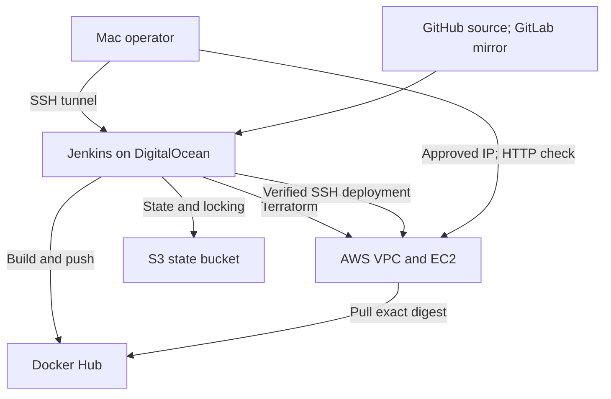

# Complete CI/CD with Terraform — Reusable Implementation Runbook

## Purpose

This runbook documents the complete implementation of a Java Maven application delivery pipeline using:

- Git and GitHub, with a GitLab mirror
- Maven and Java
- Docker and Docker Compose
- Docker Hub
- Jenkins
- Terraform
- Amazon EC2
- Amazon S3 for Terraform state
- AWS IAM
- Python and Bash
- A Jenkins controller hosted on DigitalOcean

The objective is to reproduce the project from an empty workspace without relying on chat history, an existing Jenkins installation, or undocumented configuration.

This document distinguishes:

1. The original TechWorld with Nana application and applicable training reference.
2. The project implementation and checks that were actually completed.
3. Reusable procedures and future improvements that were not demonstrated.

The project uses EC2 and Docker Compose. It does not use EKS, ECR, Kubernetes, Ansible, a database, or a Jenkins Shared Library.

---

## Final verified status

Deployment and cleanup were completed on October 11, 2026, in the America/Vancouver timezone. Jenkins and AWS logs use UTC and may show October 12.

| Item | Result |
|---|---|
| Local Maven build | Passed |
| Native application container | Passed |
| AMD64 application container on Apple Silicon | Passed |
| Host and container HTTP verification methods | Passed |
| Repeat local deployment | Reused the same container |
| Terraform validation | Passed |
| Jenkinsfile Declarative validation | Passed |
| Host-key parser checks | Six checks passed |
| Embedded Jenkins Bash syntax | Seven blocks passed |
| Jenkins build #1 | SUCCESS |
| Jenkins build #2 | SUCCESS |
| Second Terraform deployment | No infrastructure changes |
| EC2 homepage | Matched source HTML exactly |
| Application Terraform cleanup | 14 resources destroyed |
| EC2 instance | Termination verified |
| Application root EBS volume | Deletion verified |
| Backend Terraform cleanup | 5 resources destroyed |
| S3 state bucket | Deletion verified |
| Application and backend Terraform states | Empty |
| Jenkins Droplet | Deletion confirmed by operator |
| Dedicated AWS access keys | Both verified Inactive |
| Project Docker Hub token | Revocation confirmed by operator |
| GitHub and GitLab repositories | Retained |
| Published Docker Hub images | Retained |

The historical application URL is no longer live.

The dedicated IAM user, IAM policy, and inactive access keys were retained. Their deletion was not performed.

DigitalOcean snapshots, separately attached volumes, reserved addresses, and final billing inventory were not independently verified.

Manual application rollback, Jenkins backup restoration, and Terraform state restoration were not tested.

---

# 1. Project requirements, architecture, and source boundaries

## 1.1 Objective

Implement a Jenkins pipeline that:

1. Checks out the application source.
2. Builds the application JAR with Maven.
3. Builds an AMD64 Docker image.
4. Runs and verifies the image before publication.
5. Authenticates to Docker Hub and publishes a unique image tag.
6. Records the published image digest.
7. Initializes the application Terraform S3 backend.
8. Plans infrastructure changes.
9. Rejects deletion or replacement in normal deployment plans.
10. Applies the saved infrastructure plan.
11. Retrieves the EC2 instance identity and address.
12. Establishes trusted SSH host-key verification.
13. Waits for EC2 bootstrap completion.
14. Copies deployment files to EC2.
15. Deploys the exact published image digest with Docker Compose.
16. Verifies the external application response.
17. Archives the JAR and published digest.

## 1.2 Architecture



Jenkins runs inside a Docker container on the DigitalOcean host.

The Jenkins container uses the host Docker socket. The Docker daemon remains on the host.

The application runs inside a Docker container on Amazon Linux 2023 EC2.

Two independent Terraform roots are used:

| Root | Responsibility | State location |
|---|---|---|
| `bootstrap/backend/` | Create and protect the S3 state bucket | Local bootstrap state |
| `terraform/` | Create application networking, access, and EC2 | S3 application state |

The application root does not manage or destroy its own backend bucket.

## 1.3 Original source

| Item | Value |
|---|---|
| Training repository | https://gitlab.com/twn-devops-bootcamp/latest/12-terraform/java-maven-app |
| Starting branch | `feature/starting-code` |
| Imported upstream commit | `12112fb528497fe87f0c30f50a879b29d6c0a6a7` |
| Implementation reference | Upstream `jenkinsfile-sshagent` branch |
| Local root commit | `37cdadc` |

The starter was imported with `git archive`, without copying upstream Git history.

The original Jenkinsfile referenced a shared library and another developer’s image namespace and server address. It was replaced by this project’s self-contained pipeline.

The original Compose file included PostgreSQL. The application did not require that service, so it was removed.

## 1.4 Independent repositories

Primary:

https://github.com/younghadiz/complete-cicd-with-terraform

Mirror:

https://gitlab.com/devops-engineering-projects/complete-cicd-with-terraform

Local path:

```text
~/Documents/tech-workspace/devops-capstone-projects/complete-cicd-with-terraform
```

Remotes:

```text
origin  git@github.com:younghadiz/complete-cicd-with-terraform.git
gitlab  git@gitlab.com:devops-engineering-projects/complete-cicd-with-terraform.git
```

## 1.5 Recorded environment

These are historical values, not permanent addresses for future deployments.

| Item | Historical value |
|---|---|
| AWS account | `002184382122` |
| AWS region | `ca-central-1` |
| Administrator AWS profile | `default` |
| Administrator IAM identity | `myusercli` |
| Dedicated Jenkins IAM user | `jenkins-terraform-capstone` |
| Managed policy | `JenkinsTerraformCapstone` |
| State bucket | `gafari-tf-cicd-002184382122-ca-central-1` |
| Application state key | `complete-cicd-with-terraform/application/terraform.tfstate` |
| EC2 AMI | `ami-0bf6dbeae330f5823` |
| EC2 type | `t3.micro` |
| EC2 instance | `i-063e9387fb8155c11` |
| EC2 public IPv4 | `3.99.49.109` |
| Root EBS volume | `vol-0cbd17fc30b0c0a1a` |
| Fresh Jenkins Droplet | `159.203.63.2` |
| Droplet hostname | `jenkins-terraform-clean` |
| Droplet administrator | `gafari` |
| EC2 SSH username | `ec2-user` |
| Operator IPv4 | `162.156.99.186` |
| Docker Hub namespace | `younghadiz` |
| Docker Hub repository | `complete-cicd-with-terraform` |

The approved operator and Jenkins addresses were both permitted to reach EC2 on ports 22 and 8080.

## 1.6 Implementation order

The practical reproduction order is:

1. Repository and source preparation.
2. Local tool verification.
3. Application build and artifact inspection.
4. Containerization and local verification.
5. Deployment script and Jenkins pipeline preparation.
6. Terraform and IAM configuration preparation.
7. Static validation.
8. S3 backend provisioning.
9. Fresh Jenkins host provisioning and security.
10. Jenkins image, UI, tools, and credentials.
11. Dedicated-user infrastructure preflight.
12. Jenkins deployment and repeat verification.
13. Documentation and release.
14. Evidence preservation and cleanup.

Paid servers are provisioned after local checks and configuration preparation.

The state bucket is created before the application because Jenkins needs a working backend.

## 1.7 Command locations

Every command belongs to one of these environments:

| Label | Where to execute |
|---|---|
| Mac | Local operator terminal |
| Droplet root | Initial DigitalOcean root session |
| Droplet administrator | SSH session as `gafari`, using sudo |
| Jenkins UI | Browser through the SSH tunnel |
| Jenkins pipeline | Executed by the Jenkinsfile |
| EC2 | SSH session as `ec2-user` |

Run multiline shell procedures in Bash. macOS may use zsh by default.

Do not execute the entire runbook as one shell script. Some steps require cloud-console actions, interactive passwords, configuration review, or saved-plan review.

## 1.8 Secret handling

Never commit or publish:

- AWS secret access keys
- Docker Hub tokens
- Jenkins API tokens
- SSH private keys or passphrases
- Terraform state or saved plans
- Jenkins credential storage or volume backups
- Local environment inputs

Terraform receives the EC2 public key only.

Jenkins receives the EC2 private key through its credential store.

The DigitalOcean operator key is separate from the EC2 deployment key.

---

# 2. Repository preparation and attribution

## 2.1 Reproduce from the finished repository

### Mac

For routine reproduction, use the finished project:

```bash
mkdir -p "$HOME/Documents/tech-workspace/devops-capstone-projects"
cd "$HOME/Documents/tech-workspace/devops-capstone-projects"

git clone --branch main \
  https://github.com/younghadiz/complete-cicd-with-terraform.git

cd complete-cicd-with-terraform

git remote add gitlab \
  git@gitlab.com:devops-engineering-projects/complete-cicd-with-terraform.git

git remote -v
git status --short --branch
git log -5 --oneline
```

Do not clone over an existing checkout.

The complete implementation source checkpoint preserved during the project was:

```text
b87ac5d96a24e141202bd9e565260a8c2e7c36cd
```

Both successful pipeline builds used:

```text
ec97d3ef64fb336db647cf51a781f3bc94be76c1
```

Later changes preserved controller configuration and added documentation.

## 2.2 Historical starter import

This is the reconstruction of the import method used for the original empty project.

Use it only when intentionally building a new independent repository from the training starter. It is an alternative to cloning the finished project.

### Mac

```bash
bash <<'BASH'
set -euo pipefail

project_dir="$HOME/Documents/tech-workspace/devops-capstone-projects/complete-cicd-with-terraform"
baseline_sha="12112fb528497fe87f0c30f50a879b29d6c0a6a7"

mkdir -p "$project_dir"
cd "$project_dir"

if [ -n "$(ls -A)" ]; then
  printf 'Project directory must be empty for starter import.\n'
  exit 1
fi

starter_dir="$(mktemp -d "${TMPDIR:-/tmp}/terraform-capstone-starter.XXXXXX")"
trap 'rm -rf "$starter_dir"' EXIT

git clone --branch feature/starting-code --single-branch \
  https://gitlab.com/twn-devops-bootcamp/latest/12-terraform/java-maven-app.git \
  "$starter_dir"

git -C "$starter_dir" checkout --detach "$baseline_sha"
git -C "$starter_dir" archive HEAD | tar -x -C "$project_dir"

git init -b main

printf 'Imported starter commit: '
git -C "$starter_dir" rev-parse HEAD

git status --short --branch
BASH
```

The project then added attribution and ignore rules before the baseline commit.

## 2.3 Source attribution file

Path: `SOURCES.md`

```markdown
# Source Attribution

## Starting application

This project imports the Java Maven application and starter deployment
files from TechWorld with Nana's DevOps Bootcamp repository.

- Repository: https://gitlab.com/twn-devops-bootcamp/latest/12-terraform/java-maven-app
- Branch: feature/starting-code
- Baseline commit: 12112fb528497fe87f0c30f50a879b29d6c0a6a7

The starter files were imported without the upstream Git history.
This repository maintains an independent implementation history.

## Implementation reference

The upstream jenkinsfile-sshagent branch is the reference for integrating
Terraform provisioning with Jenkins and deploying to EC2 using Docker Compose.

Project-specific changes are recorded in this repository's commits.
```

## 2.4 Ignore rules

Path: `.gitignore`

```gitignore
# Editors and macOS
.idea/
.vscode/
.DS_Store

# Maven build output
target/

# Terraform generated files and sensitive state
**/.terraform/*
*.tfstate
*.tfstate.*
*.tfplan
*.tfplan.*
crash.log
crash.*.log
*.tfvars
*.tfvars.json
!*.example.tfvars
!*.example.tfvars.json

# Local environment files
.env
.env.*
!.env.example
!.env.*.example

# Private keys
*.pem
*.key
id_rsa
id_ed25519

# Local Terraform backend settings
/terraform/backend.local.hcl
```

Provider lock files and sanitized example inputs remain eligible for Git.

## 2.5 Independent branches and remotes

Historical branch setup:

```bash
git add \
  .gitignore SOURCES.md Dockerfile Jenkinsfile \
  docker-compose.yaml pom.xml server-cmds.sh src/

git diff --cached --stat

git commit -m "chore: import attributed Terraform capstone starter"

git switch -c develop
git switch -c feature/terraform-cicd
```

Add remotes only if they do not already exist:

```bash
git remote add origin \
  git@github.com:younghadiz/complete-cicd-with-terraform.git

git remote add gitlab \
  git@gitlab.com:devops-engineering-projects/complete-cicd-with-terraform.git
```

Initial publication:

```bash
git push -u origin main
git push -u origin develop
git push -u origin feature/terraform-cicd

git push gitlab main develop feature/terraform-cicd

git ls-remote --heads origin
git ls-remote --heads gitlab
git branch -vv
```

GitHub remains the upstream tracking remote. GitLab is pushed explicitly as a mirror.

---

# 3. Local tools, application build, and artifact

## 3.1 Verify local tools

### Mac

```bash
cd "$HOME/Documents/tech-workspace/devops-capstone-projects/complete-cicd-with-terraform"

pwd
git --version
uname -m
java -version
mvn --version
docker --version
docker compose version
terraform version
aws --version
python3 --version
```

The verified local Mac was ARM64 and used Java 17.

The project used Terraform 1.15.6. An update notice did not indicate a project failure.

## 3.2 Start Docker Desktop

The initial Docker check failed with:

```text
failed to connect to the docker API
~/.docker/run/docker.sock: no such file or directory
```

The Docker client was installed, but the engine was not running.

Corrective action:

```bash
open -a Docker
```

After Docker Desktop starts:

```bash
docker info --format 'Docker server: {{.ServerVersion}}'
docker compose version
```

Changing directories does not start the Docker engine.

## 3.3 Application source

Path: `src/main/java/com/example/Application.java`

```java
package com.example;

import org.springframework.boot.SpringApplication;
import org.springframework.boot.autoconfigure.SpringBootApplication;
import org.slf4j.Logger;
import org.slf4j.LoggerFactory;
import jakarta.annotation.PostConstruct;

@SpringBootApplication
public class Application {

    public static void main(String[] args)
    {
        SpringApplication.run(Application.class, args);
    }

    @PostConstruct
    public void init()
    {
        Logger log = LoggerFactory.getLogger(Application.class);
        log.info("Java app started");
    }

    public String getStatus() {
        return "OK";
    }
}
```

`getStatus()` is an ordinary method. It is not a mapped HTTP endpoint.

The verified web endpoint is `/`, served from the static HTML file.

Path: `src/main/resources/static/index.html`

```html
<!DOCTYPE html>
<html lang="en">
<head>
    <meta charset="UTF-8">
    <title>MyApp</title>
</head>
<body>
<h1>Welcome to Java Maven Application</h1>
<!-- add image here   -->
</body>
</html>
```

## 3.4 Maven configuration

Path: `pom.xml`

```xml
<?xml version="1.0" encoding="UTF-8"?>
<project xmlns="http://maven.apache.org/POM/4.0.0"
         xmlns:xsi="http://www.w3.org/2001/XMLSchema-instance"
         xsi:schemaLocation="http://maven.apache.org/POM/4.0.0 http://maven.apache.org/xsd/maven-4.0.0.xsd">
    <modelVersion>4.0.0</modelVersion>

    <groupId>com.example</groupId>
    <artifactId>java-maven-app</artifactId>
    <version>1.0-SNAPSHOT</version>

    <build>
        <plugins>
            <plugin>
                <groupId>org.springframework.boot</groupId>
                <artifactId>spring-boot-maven-plugin</artifactId>
                <version>3.5.5</version>
                <executions>
                    <execution>
                        <goals>
                            <goal>repackage</goal>
                        </goals>
                    </execution>
                </executions>
            </plugin>

            <plugin>
                <groupId>org.apache.maven.plugins</groupId>
                <artifactId>maven-compiler-plugin</artifactId>
                <version>3.11.0</version>
                <configuration>
                    <source>17</source>
                    <target>17</target>
                </configuration>
            </plugin>
        </plugins>
    </build>

    <dependencies>
        <dependency>
            <groupId>org.springframework.boot</groupId>
            <artifactId>spring-boot-starter-web</artifactId>
            <version>3.5.5</version>
        </dependency>

        <dependency>
            <groupId>junit</groupId>
            <artifactId>junit</artifactId>
            <version>4.13.2</version>
            <scope>test</scope>
        </dependency>

        <dependency>
            <groupId>net.logstash.logback</groupId>
            <artifactId>logstash-logback-encoder</artifactId>
            <version>9.0</version>
        </dependency>
    </dependencies>

</project>
```

## 3.5 Build and verify

```bash
mvn --batch-mode --no-transfer-progress clean verify
```

Verified result:

```text
BUILD SUCCESS
No tests to run.
```

No application unit-test source files were added.

The presence of the JUnit dependency does not mean application tests ran.

The project separately verified:

- Application HTTP responses
- Container runtime identity and architecture
- Deployment repeatability
- Terraform configuration
- Jenkinsfile structure and shell syntax
- SSH host-key parsing

## 3.6 Artifact

Generated artifact:

```text
target/java-maven-app-1.0-SNAPSHOT.jar
```

The Spring Boot repackage goal creates an executable JAR.

Inspect it:

```bash
ls -lh target/java-maven-app-1.0-SNAPSHOT.jar
jar tf target/java-maven-app-1.0-SNAPSHOT.jar | head -30
git status --short --branch
```

`target/` is ignored and must not be committed.

## 3.7 Maven warnings observed

Observed warnings included:

- Platform encoding was not explicitly configured.
- Jenkins JDK 21 compiling with `source`/`target` 17 produced a system-modules-path warning.

The application built and ran successfully.

A future improvement is to use explicit UTF-8 encoding and compiler `release=17`. Those changes were not part of the verified implementation.

---

# 4. Containerization and verified deployment script

## 4.1 Dockerfile

Path: `Dockerfile`

```dockerfile
FROM amazoncorretto:17-alpine-jdk

WORKDIR /app

COPY target/java-maven-app-*.jar /app/app.jar

USER 10001:10001

EXPOSE 8080

ENTRYPOINT ["java", "-jar", "/app/app.jar"]
```

The application runs as numeric user/group `10001:10001`.

The image uses the already-built JAR. Maven runs before Docker build.

The wildcard expects the intended application JAR to be the matching artifact in `target/`.

## 4.2 Docker build context

Path: `.dockerignore`

```dockerignore
**
!Dockerfile
!target/
!target/java-maven-app-*.jar
```

Only the Dockerfile and matching JAR are needed by this image build.

## 4.3 Application Compose file

Path: `docker-compose.yaml`

```yaml
services:
  java-maven-app:
    image: "${IMAGE:?Set IMAGE to the application image reference}"
    ports:
      - "${APP_BIND_ADDRESS:-127.0.0.1}:${APP_PORT:-8080}:8080"
    restart: unless-stopped
```

There is no database service.

The Compose file alone defaults to loopback binding.

The deployment script defaults `APP_BIND_ADDRESS` to `0.0.0.0` for EC2 deployment. EC2 security-group rules restrict who can reach that port.

Local verification explicitly sets loopback binding.

## 4.4 Deployment script

Path: `server-cmds.sh`

```bash
#!/usr/bin/env bash
set -euo pipefail

# Usage:
#   ./server-cmds.sh IMAGE [DOCKER_HUB_USERNAME]
# If a username is supplied, provide the registry token on standard input.

export IMAGE="${1:?Usage: server-cmds.sh IMAGE [DOCKER_HUB_USERNAME]}"
registry_user="${2:-}"

if [[ "$IMAGE" == -* || "$IMAGE" =~ [[:space:]] ]]; then
  printf 'Invalid image reference.\n' >&2
  exit 1
fi

export APP_BIND_ADDRESS="${APP_BIND_ADDRESS:-0.0.0.0}"
export APP_PORT="${APP_PORT:-8080}"
export COMPOSE_PROJECT_NAME="${COMPOSE_PROJECT_NAME:-complete-cicd-with-terraform}"

pull_image="${PULL_IMAGE:-true}"

case "$pull_image" in
  true|false) ;;
  *)
    printf 'PULL_IMAGE must be true or false.\n' >&2
    exit 1
    ;;
esac

cd "$(dirname "${BASH_SOURCE[0]}")"

registry_config=""
response_file="$(mktemp)"

cleanup() {
  rm -f "$response_file"
  if [ -n "$registry_config" ]; then
    rm -rf "$registry_config"
  fi
}
trap cleanup EXIT

docker info >/dev/null
docker compose version
docker compose -f docker-compose.yaml config --quiet

if [ -n "$registry_user" ]; then
  registry_config="$(mktemp -d)"
  chmod 700 "$registry_config"
  export DOCKER_CONFIG="$registry_config"

  docker login \
    --username "$registry_user" \
    --password-stdin
fi

if [ "$pull_image" = "true" ]; then
  docker compose -f docker-compose.yaml pull java-maven-app
else
  docker image inspect "$IMAGE" >/dev/null
fi

docker compose -f docker-compose.yaml up -d --no-build

verify_method="${VERIFY_METHOD:-host}"

case "$verify_method" in
  host|container) ;;
  *)
    printf 'VERIFY_METHOD must be host or container.\n' >&2
    exit 1
    ;;
esac

probe_container="$(
  docker compose -f docker-compose.yaml ps -q java-maven-app
)"
test -n "$probe_container"

fetch_homepage() {
  if [ "$verify_method" = "container" ]; then
    docker exec "$probe_container" \
      /bin/busybox wget -q -T 5 -O - \
      http://127.0.0.1:8080/ > "$response_file"
  else
    curl --fail --silent \
      --connect-timeout 2 \
      --max-time 5 \
      "http://127.0.0.1:${APP_PORT}/" \
      -o "$response_file"
  fi
}

ready=false

for attempt in {1..30}; do
  if fetch_homepage; then
    if grep -Fq \
      '<h1>Welcome to Java Maven Application</h1>' \
      "$response_file"; then
      ready=true
      break
    fi
  fi

  sleep 2
done

if [ "$ready" != "true" ]; then
  printf 'FAILED: application readiness verification.\n' >&2
  docker compose -f docker-compose.yaml ps
  docker compose -f docker-compose.yaml logs --tail 100 --no-color
  exit 1
fi

container_id="$(
  docker compose -f docker-compose.yaml ps -q java-maven-app
)"
test -n "$container_id"

actual_image="$(
  docker inspect --format '{{.Config.Image}}' "$container_id"
)"
test "$actual_image" = "$IMAGE"

test "$(
  docker inspect --format '{{.State.Running}}' "$container_id"
)" = "true"

docker compose -f docker-compose.yaml ps

printf 'PASS: %s is running and serves the expected homepage.\n' "$IMAGE"
```

Restore executable permission:

```bash
chmod +x server-cmds.sh
bash -n server-cmds.sh
git diff --check
```

## 4.5 Why two verification methods exist

| Method | Request location | Use |
|---|---|---|
| `host` | The machine executing the script | Mac local test and EC2 |
| `container` | Inside the application container | Jenkins using host Docker socket |

Jenkins is inside its own container. Its `127.0.0.1` is not the DigitalOcean host’s loopback address.

Publishing the test application on the Docker host’s `127.0.0.1:18080` does not make it available at Jenkins container localhost.

The correction was:

```bash
export VERIFY_METHOD="container"
```

The application container is probed using BusyBox wget.

External EC2 HTTP verification remains a separate final pipeline check.

## 4.6 AMD64 local test

### Mac

```bash
bash <<'BASH'
set -euo pipefail

cd "$HOME/Documents/tech-workspace/devops-capstone-projects/complete-cicd-with-terraform"

mvn --batch-mode --no-transfer-progress clean verify

export IMAGE="complete-cicd-with-terraform:amd64-check"
export APP_BIND_ADDRESS="127.0.0.1"
export APP_PORT="18080"
export COMPOSE_PROJECT_NAME="terraform-local-check-$$"
export PULL_IMAGE="false"

docker build \
  --platform linux/amd64 \
  --tag "$IMAGE" \
  .

test "$(docker image inspect "$IMAGE" --format '{{.Architecture}}')" = "amd64"

cleanup() {
  docker compose -f docker-compose.yaml down
}
trap cleanup EXIT

VERIFY_METHOD=container ./server-cmds.sh "$IMAGE"
VERIFY_METHOD=host ./server-cmds.sh "$IMAGE"

curl --fail --silent --show-error \
  --max-time 5 \
  http://127.0.0.1:18080/ \
  -o target/local-homepage.html

cmp \
  src/main/resources/static/index.html \
  target/local-homepage.html

docker image inspect "$IMAGE" \
  --format 'User={{.Config.User}} Platform={{.Os}}/{{.Architecture}}'

git diff --check
git status --short --branch
BASH
```

Verified results:

```text
User=10001:10001
Architecture=amd64
HTTP verification passed
Homepage matched source HTML
```

On Apple Silicon, the AMD64/ARM64 platform warning was expected. The AMD64 image ran under emulation.

## 4.7 Repeat deployment check

Within a local test environment with the same `IMAGE`, port, and Compose project:

```bash
./server-cmds.sh "$IMAGE"

first_container="$(
  docker compose -f docker-compose.yaml ps -q java-maven-app
)"

./server-cmds.sh "$IMAGE"

second_container="$(
  docker compose -f docker-compose.yaml ps -q java-maven-app
)"

test -n "$first_container"
test "$first_container" = "$second_container"

printf 'PASS: repeated deployment reused the same container.\n'
```

This passed during implementation.

The script is repeatable for the same image and configuration. A changed image digest can recreate the container.

## 4.8 Startup retries

Several initial responses were:

```text
wget: can't connect to remote host (127.0.0.1): Connection refused
```

These occurred while Spring Boot started.

The eventual PASS result is what matters. A final readiness failure is not normal and requires container logs.

---

# 5. Terraform application configuration

## 5.1 Create directories

### Mac

```bash
mkdir -p terraform/scripts bootstrap/backend iam scripts infrastructure/jenkins
```

All paths below are relative to the repository root.

## 5.2 Terraform version and application backend

Path: `terraform/versions.tf`

```hcl
terraform {
  required_version = ">= 1.10.0, < 2.0.0"

  required_providers {
    aws = {
      source  = "hashicorp/aws"
      version = "~> 6.0"
    }
  }

  backend "s3" {}
}
```

The backend configuration is supplied separately.

## 5.3 Provider account guard and tags

Path: `terraform/providers.tf`

```hcl
provider "aws" {
  region              = var.aws_region
  allowed_account_ids = [var.expected_account_id]

  default_tags {
    tags = {
      Project   = var.project_name
      ManagedBy = "Terraform"
      Owner     = "Gafari"
    }
  }
}
```

Path: `terraform/variables.tf`

```hcl
variable "aws_region" {
  description = "AWS region for the capstone infrastructure."
  type        = string
  default     = "ca-central-1"
}

variable "expected_account_id" {
  description = "AWS account in which provisioning is permitted."
  type        = string
  default     = "002184382122"

  validation {
    condition     = can(regex("^[0-9]{12}$", var.expected_account_id))
    error_message = "expected_account_id must contain exactly 12 digits."
  }
}

variable "project_name" {
  description = "Project prefix used for resource names and tags."
  type        = string
  default     = "complete-cicd-with-terraform"
}
```

## 5.4 Network

Path: `terraform/network.tf`

```hcl
resource "aws_vpc" "app" {
  cidr_block           = "10.30.0.0/16"
  enable_dns_support   = true
  enable_dns_hostnames = true

  tags = {
    Name = "${var.project_name}-vpc"
  }
}

resource "aws_subnet" "public" {
  vpc_id     = aws_vpc.app.id
  cidr_block = "10.30.1.0/24"

  tags = {
    Name = "${var.project_name}-public"
  }
}

resource "aws_internet_gateway" "app" {
  vpc_id = aws_vpc.app.id

  tags = {
    Name = "${var.project_name}-igw"
  }
}

resource "aws_route_table" "public" {
  vpc_id = aws_vpc.app.id

  tags = {
    Name = "${var.project_name}-public"
  }
}

resource "aws_route" "internet" {
  route_table_id         = aws_route_table.public.id
  destination_cidr_block = "0.0.0.0/0"
  gateway_id             = aws_internet_gateway.app.id
}

resource "aws_route_table_association" "public" {
  subnet_id      = aws_subnet.public.id
  route_table_id = aws_route_table.public.id
}
```

The subnet does not enable automatic public-IP assignment for all instances.

The application instance explicitly requests a public IPv4 address.

## 5.5 Access inputs

Path: `terraform/access-variables.tf`

```hcl
variable "ssh_public_key" {
  description = "OpenSSH public key for Jenkins deployment access."
  type        = string

  validation {
    condition     = can(regex("^ssh-ed25519 ", trimspace(var.ssh_public_key)))
    error_message = "Provide the project's OpenSSH ED25519 public key."
  }
}

variable "ssh_allowed_cidrs" {
  description = "IPv4 CIDRs permitted to connect over SSH."
  type        = set(string)
  default     = []

  validation {
    condition = alltrue([
      for cidr in var.ssh_allowed_cidrs :
      can(cidrnetmask(cidr)) && cidr != "0.0.0.0/0"
    ])
    error_message = "Provide valid IPv4 CIDRs; unrestricted SSH is not permitted."
  }
}

variable "app_allowed_cidrs" {
  description = "IPv4 CIDRs permitted to access the application on port 8080."
  type        = set(string)
  default     = []

  validation {
    condition = alltrue([
      for cidr in var.app_allowed_cidrs :
      can(cidrnetmask(cidr)) && cidr != "0.0.0.0/0"
    ])
    error_message = "Provide valid, restricted IPv4 CIDRs for application access."
  }
}
```

The validations reject literal `0.0.0.0/0`. They do not enforce `/32` or prevent all possible combinations of broad networks.

The verified inputs used two approved `/32` addresses.

## 5.6 Key pair and security group

Path: `terraform/access.tf`

```hcl
resource "aws_key_pair" "deployment" {
  key_name   = "${var.project_name}-deployment"
  public_key = trimspace(var.ssh_public_key)
}

resource "aws_security_group" "app" {
  name_prefix = "${var.project_name}-"
  description = "Restricted access to the capstone application server"
  vpc_id      = aws_vpc.app.id

  tags = {
    Name = "${var.project_name}-app"
  }
}

resource "aws_vpc_security_group_ingress_rule" "ssh" {
  for_each = var.ssh_allowed_cidrs

  security_group_id = aws_security_group.app.id
  description       = "SSH from an approved deployment or administration network"
  cidr_ipv4         = each.value
  ip_protocol       = "tcp"
  from_port         = 22
  to_port           = 22
}

resource "aws_vpc_security_group_ingress_rule" "application" {
  for_each = var.app_allowed_cidrs

  security_group_id = aws_security_group.app.id
  description       = "Application access from an approved network"
  cidr_ipv4         = each.value
  ip_protocol       = "tcp"
  from_port         = 8080
  to_port           = 8080
}

resource "aws_vpc_security_group_egress_rule" "internet" {
  security_group_id = aws_security_group.app.id
  description       = "Outbound access for DNS, package installation and image pulls"
  cidr_ipv4         = "0.0.0.0/0"
  ip_protocol       = "-1"
}
```

Outbound access is broad. This was suitable for the demonstration but is not an egress containment design.

## 5.7 Compute variables

Path: `terraform/compute-variables.tf`

```hcl
variable "ami_id" {
  description = "Explicit Amazon Linux 2023 x86-64 AMI ID in the selected region."
  type        = string

  validation {
    condition     = can(regex("^ami-([0-9a-f]{8}|[0-9a-f]{17})$", var.ami_id))
    error_message = "Provide a valid EC2 AMI ID."
  }
}

variable "instance_type" {
  description = "EC2 instance type for the demonstration application."
  type        = string
  default     = "t3.micro"

  validation {
    condition     = contains(["t3.micro", "t3.small"], var.instance_type)
    error_message = "Choose t3.micro or t3.small for this capstone."
  }
}
```

## 5.8 EC2 instance

Path: `terraform/compute.tf`

```hcl
resource "aws_instance" "app" {
  ami                         = var.ami_id
  instance_type               = var.instance_type
  subnet_id                   = aws_subnet.public.id
  vpc_security_group_ids      = [aws_security_group.app.id]
  key_name                    = aws_key_pair.deployment.key_name
  associate_public_ip_address = true

  user_data                   = file("${path.module}/scripts/bootstrap.sh")
  user_data_replace_on_change = true

  metadata_options {
    http_endpoint = "enabled"
    http_tokens   = "required"
  }

  root_block_device {
    volume_type           = "gp3"
    volume_size           = 10
    encrypted             = true
    delete_on_termination = true
  }

  depends_on = [
    aws_route.internet,
    aws_route_table_association.public,
    aws_vpc_security_group_egress_rule.internet
  ]

  tags = {
    Name = "${var.project_name}-app"
  }
}
```

The configuration requires IMDSv2 and encrypts the root volume.

Changing the AMI or user data may require replacement. The Jenkins plan guard rejects plans containing deletion.

## 5.9 Outputs

Path: `terraform/outputs.tf`

```hcl
output "instance_id" {
  description = "Managed application EC2 instance ID."
  value       = aws_instance.app.id
}

output "instance_public_ip" {
  description = "Application server address for SSH deployment."
  value       = aws_instance.app.public_ip
}

output "ssh_user" {
  description = "SSH username for the Amazon Linux application server."
  value       = "ec2-user"
}

output "deployment_key_name" {
  description = "Registered EC2 deployment key name."
  value       = aws_key_pair.deployment.key_name
}

output "application_url" {
  description = "Application URL, accessible from approved networks after deployment."
  value       = "http://${aws_instance.app.public_ip}:8080"
}
```

## 5.10 EC2 bootstrap script

Path: `terraform/scripts/bootstrap.sh`

```bash
#!/usr/bin/env bash
set -euo pipefail

exec > >(tee -a /var/log/capstone-bootstrap.log) 2>&1

printf 'Starting capstone server bootstrap\n'

mkdir -p /var/lib/capstone
rm -f /var/lib/capstone/bootstrap-ready

test "$(uname -m)" = "x86_64"

dnf install -y docker

mkdir -p /etc/docker

cat > /etc/docker/daemon.json <<'JSON'
{
  "log-driver": "json-file",
  "log-opts": {
    "max-size": "10m",
    "max-file": "3"
  }
}
JSON

compose_version="v2.39.4"
compose_asset="docker-compose-linux-x86_64"
compose_url="https://github.com/docker/compose/releases/download/${compose_version}"

bootstrap_tmp="$(mktemp -d)"
trap 'rm -rf "$bootstrap_tmp"' EXIT

curl --fail --location \
  --retry 5 --retry-delay 3 \
  --connect-timeout 15 --max-time 180 \
  "${compose_url}/${compose_asset}" \
  -o "${bootstrap_tmp}/${compose_asset}"

curl --fail --location \
  --retry 5 --retry-delay 3 \
  --connect-timeout 15 --max-time 60 \
  "${compose_url}/${compose_asset}.sha256" \
  -o "${bootstrap_tmp}/${compose_asset}.sha256"

expected_sha="$(
  awk 'NR == 1 {print $1}' \
    "${bootstrap_tmp}/${compose_asset}.sha256"
)"

[[ "$expected_sha" =~ ^[0-9a-fA-F]{64}$ ]]

printf '%s  %s\n' \
  "$expected_sha" \
  "${bootstrap_tmp}/${compose_asset}" |
  sha256sum --check -

install -d -m 0755 /usr/local/lib/docker/cli-plugins

install -m 0755 \
  "${bootstrap_tmp}/${compose_asset}" \
  /usr/local/lib/docker/cli-plugins/docker-compose

usermod -aG docker ec2-user

install -d \
  -o ec2-user \
  -g ec2-user \
  -m 0750 \
  /opt/complete-cicd-with-terraform

systemctl enable --now docker

docker info >/dev/null
docker compose version

touch /var/lib/capstone/bootstrap-ready

printf 'Capstone server bootstrap completed\n'
```

Validate syntax:

```bash
chmod +x terraform/scripts/bootstrap.sh
bash -n terraform/scripts/bootstrap.sh
```

The marker is created only after Docker and Compose checks pass.

The deployment pipeline waits for this marker.

Checksum verification detects archive corruption or mismatch. Downloading the checksum from the same release location is not independent signature verification.

## 5.11 Sanitized examples

Path: `terraform/terraform.example.tfvars`

```hcl
aws_region          = "ca-central-1"
expected_account_id = "002184382122"
project_name        = "complete-cicd-with-terraform"

# Verify an Amazon Linux 2023 x86-64 AMI in the selected region.
ami_id        = "ami-0bf6dbeae330f5823"
instance_type = "t3.micro"

# Replace with your deployment public key.
ssh_public_key = "ssh-ed25519 REPLACE_WITH_PUBLIC_KEY"

# Add the Jenkins public IP and approved administration IP as /32 CIDRs.
ssh_allowed_cidrs = []

# Add approved application-testing IPs as /32 CIDRs.
app_allowed_cidrs = []
```

Path: `terraform/backend.example.hcl`

```hcl
bucket       = "REPLACE_WITH_YOUR_PROJECT_STATE_BUCKET"
key          = "complete-cicd-with-terraform/application/terraform.tfstate"
region       = "ca-central-1"
encrypt      = true
use_lockfile = true
```

Do not deploy placeholder inputs.

Empty access sets create no permitted ingress rules.

---

# 6. Separate S3 backend configuration

## 6.1 Bootstrap version and local state

Path: `bootstrap/backend/versions.tf`

```hcl
terraform {
  required_version = ">= 1.10.0, < 2.0.0"

  required_providers {
    aws = {
      source  = "hashicorp/aws"
      version = "~> 6.0"
    }
  }

  backend "local" {
    path = "terraform.tfstate"
  }
}
```

## 6.2 Bootstrap provider

Path: `bootstrap/backend/providers.tf`

```hcl
provider "aws" {
  region              = var.aws_region
  allowed_account_ids = [var.expected_account_id]

  default_tags {
    tags = {
      Project   = "complete-cicd-with-terraform"
      Component = "TerraformState"
      ManagedBy = "Terraform"
      Owner     = "Gafari"
    }
  }
}
```

## 6.3 Bootstrap variables

Path: `bootstrap/backend/variables.tf`

```hcl
variable "aws_region" {
  description = "Region for the Terraform state bucket."
  type        = string
  default     = "ca-central-1"
}

variable "expected_account_id" {
  description = "Account permitted to manage the state bucket."
  type        = string
  default     = "002184382122"
}

variable "state_bucket_name" {
  description = "Globally unique bucket name matching the application backend configuration."
  type        = string
  default     = "gafari-tf-cicd-002184382122-ca-central-1"
}
```

## 6.4 Protected bucket

Path: `bootstrap/backend/main.tf`

```hcl
resource "aws_s3_bucket" "state" {
  bucket        = var.state_bucket_name
  force_destroy = false

  lifecycle {
    prevent_destroy = true
  }
}

resource "aws_s3_bucket_versioning" "state" {
  bucket = aws_s3_bucket.state.id

  versioning_configuration {
    status = "Enabled"
  }
}

resource "aws_s3_bucket_server_side_encryption_configuration" "state" {
  bucket = aws_s3_bucket.state.id

  rule {
    apply_server_side_encryption_by_default {
      sse_algorithm = "AES256"
    }
  }
}

resource "aws_s3_bucket_public_access_block" "state" {
  bucket = aws_s3_bucket.state.id

  block_public_acls       = true
  block_public_policy     = true
  ignore_public_acls      = true
  restrict_public_buckets = true
}

resource "aws_s3_bucket_policy" "https_only" {
  bucket = aws_s3_bucket.state.id

  policy = jsonencode({
    Version = "2012-10-17"
    Statement = [
      {
        Sid       = "DenyInsecureTransport"
        Effect    = "Deny"
        Principal = "*"
        Action    = "s3:*"
        Resource = [
          aws_s3_bucket.state.arn,
          "${aws_s3_bucket.state.arn}/*"
        ]
        Condition = {
          Bool = {
            "aws:SecureTransport" = "false"
          }
        }
      }
    ]
  })
}
```

## 6.5 Bootstrap outputs

Path: `bootstrap/backend/outputs.tf`

```hcl
output "state_bucket_name" {
  description = "Bucket used by the application Terraform backend."
  value       = aws_s3_bucket.state.id
}

output "state_bucket_region" {
  description = "Region used in the application backend configuration."
  value       = var.aws_region
}
```

## 6.6 Provider lock files

The verified AWS provider was `6.67.0`.

The same lock file was preserved in:

- `terraform/.terraform.lock.hcl`
- `bootstrap/backend/.terraform.lock.hcl`

Full recorded content:

```hcl
# This file is maintained automatically by "terraform init".
# Manual edits may be lost in future updates.

provider "registry.terraform.io/hashicorp/aws" {
  version     = "6.67.0"
  constraints = "~> 6.0"
  hashes = [
    "h1:EB9ixYOZrSlYD7wtJxf88qwoyyWrlKDKxhzaCLIb3t4=",
    "h1:OgdIUAQDtJBxlKjoPgChD1w57vl6hm6PyJHiBYgsgQA=",
    "zh:111d5686a1f4ccbc888bb5e2229308bcdd9149898c6af97969fcdfb0e7bd2aa0",
    "zh:21b3b7693bd9754c039fd546f03ed09e7510c6189aa5ee37176f144cf8dd5f95",
    "zh:25e03c7f025ff4851889537605aa560d2e39bd738b33a5204b8037eb164b475f",
    "zh:2817a046f1060e25bf04b0eb78f4e251130bb92dc82ec1264ce156dc9bf78e67",
    "zh:2d318d674c3ec9dbd97ddb10b12ad4827be4f508c43ba2ae1e0523baa9e367e3",
    "zh:2f07ab356718267299e10b6072472ded29d82753883027bf43bcd687ac72feb2",
    "zh:32307e67f83bc0dc94d38cfcd23d782166a09e0e975e2a5aa7d7a3e7ca5d3da8",
    "zh:4ce94853264097dd7f4542b3cfd18d2b98b06d23321db45d5e384ea275a57f63",
    "zh:869656c41cc7c7412f213e488f98167cff61deafcb8cf245d25d056e8dfdc263",
    "zh:8fd8c814e9d8edf152552047db23bf5b5d63f22e6b0b5d47b2af851376e99349",
    "zh:9b12af85486a96aedd8d7984b0ff811a4b42e3d88dad1a3fb4c0b580d04fa425",
    "zh:9cbc02ceef9bd469da497a1e7065ff984bdacfbe919ac3cce804a86c13b6e2c6",
    "zh:9ea55dda2767acfc1f6337fc7d29b1d4d79d6f8f04871f8ad99a6078d2865994",
    "zh:d7149df0819fb57a160489db45d33951765b8f0118daa3b4cd549a0135bc97a1",
    "zh:e5819937bb7043d08c9829b32d52d9fb55a5b9a4d8d55d550d47a3d7392db546",
    "zh:f93bc38dbc0ad53842303f30eec7a22c525c4d56209b54ec33a8d375cfc4e4fd",
  ]
}
```

The project obtained checksums for both the Mac and Linux Jenkins platform:

```bash
terraform -chdir=terraform init -backend=false

terraform -chdir=terraform providers lock \
  -platform=darwin_arm64 \
  -platform=linux_amd64

cp terraform/.terraform.lock.hcl \
  bootstrap/backend/.terraform.lock.hcl

terraform -chdir=terraform fmt -check
terraform -chdir=terraform validate

terraform -chdir=bootstrap/backend init -input=false -lockfile=readonly
terraform -chdir=bootstrap/backend fmt -check
terraform -chdir=bootstrap/backend validate
```

These commands initialize providers and validate configuration. They do not provision application resources.

## 6.7 Provision the backend

### Mac administrator

Verify identity:

```bash
aws configure list-profiles

aws --profile default --region ca-central-1 sts get-caller-identity \
  --query '{Account:Account,Arn:Arn}' \
  --output json
```

Plan:

```bash
bash <<'BASH'
set -euo pipefail

cd "$HOME/Documents/tech-workspace/devops-capstone-projects/complete-cicd-with-terraform"

export AWS_PROFILE=default
export AWS_REGION=ca-central-1
export AWS_DEFAULT_REGION="$AWS_REGION"
unset AWS_ACCESS_KEY_ID AWS_SECRET_ACCESS_KEY AWS_SESSION_TOKEN

test "$(aws sts get-caller-identity --query Account --output text)" = "002184382122"

terraform -chdir=bootstrap/backend init \
  -input=false \
  -lockfile=readonly

terraform -chdir=bootstrap/backend validate

terraform -chdir=bootstrap/backend plan \
  -input=false \
  -out=backend.tfplan

git check-ignore bootstrap/backend/backend.tfplan
BASH
```

Review:

```text
Plan: 5 to add, 0 to change, 0 to destroy.
```

Apply the reviewed saved plan:

```bash
AWS_PROFILE=default AWS_REGION=ca-central-1 \
  terraform -chdir=bootstrap/backend apply \
  -input=false \
  backend.tfplan

terraform -chdir=bootstrap/backend output
```

Verified result:

```text
Apply complete! Resources: 5 added, 0 changed, 0 destroyed.
```

## 6.8 Verify bucket protections

```bash
aws --profile default --region ca-central-1 s3api get-bucket-versioning \
  --bucket gafari-tf-cicd-002184382122-ca-central-1 \
  --expected-bucket-owner 002184382122

aws --profile default --region ca-central-1 s3api get-bucket-encryption \
  --bucket gafari-tf-cicd-002184382122-ca-central-1 \
  --expected-bucket-owner 002184382122

aws --profile default --region ca-central-1 s3api get-public-access-block \
  --bucket gafari-tf-cicd-002184382122-ca-central-1 \
  --expected-bucket-owner 002184382122

aws --profile default --region ca-central-1 s3api get-bucket-policy \
  --bucket gafari-tf-cicd-002184382122-ca-central-1 \
  --expected-bucket-owner 002184382122 \
  --query Policy \
  --output text
```

Verified:

- Versioning: Enabled
- Encryption: AES256
- All four public-access blocks: true
- HTTPS-only deny policy: present

Preserve the local bootstrap state privately.

Do not delete that state file while the bucket exists.

---

# 7. Dedicated Jenkins AWS identity and deployment keys

## 7.1 IAM policy

Path: `iam/jenkins-terraform-policy.json`

```json
{
  "Version": "2012-10-17",
  "Statement": [
    {
      "Sid": "ManageCapstoneEC2Region",
      "Effect": "Allow",
      "Action": [
        "ec2:Describe*",
        "ec2:GetConsoleOutput",
        "ec2:CreateVpc",
        "ec2:DeleteVpc",
        "ec2:ModifyVpcAttribute",
        "ec2:CreateSubnet",
        "ec2:DeleteSubnet",
        "ec2:ModifySubnetAttribute",
        "ec2:CreateInternetGateway",
        "ec2:DeleteInternetGateway",
        "ec2:AttachInternetGateway",
        "ec2:DetachInternetGateway",
        "ec2:CreateRouteTable",
        "ec2:DeleteRouteTable",
        "ec2:CreateRoute",
        "ec2:DeleteRoute",
        "ec2:ReplaceRoute",
        "ec2:AssociateRouteTable",
        "ec2:DisassociateRouteTable",
        "ec2:ReplaceRouteTableAssociation",
        "ec2:CreateSecurityGroup",
        "ec2:DeleteSecurityGroup",
        "ec2:AuthorizeSecurityGroupIngress",
        "ec2:RevokeSecurityGroupIngress",
        "ec2:AuthorizeSecurityGroupEgress",
        "ec2:RevokeSecurityGroupEgress",
        "ec2:ModifySecurityGroupRules",
        "ec2:UpdateSecurityGroupRuleDescriptionsIngress",
        "ec2:UpdateSecurityGroupRuleDescriptionsEgress",
        "ec2:ImportKeyPair",
        "ec2:DeleteKeyPair",
        "ec2:RunInstances",
        "ec2:TerminateInstances",
        "ec2:StartInstances",
        "ec2:StopInstances",
        "ec2:ModifyInstanceAttribute",
        "ec2:ModifyInstanceMetadataOptions",
        "ec2:ModifyInstanceCreditSpecification",
        "ec2:ModifyVolume",
        "ec2:CreateTags",
        "ec2:DeleteTags"
      ],
      "Resource": "*",
      "Condition": {
        "StringEquals": {
          "aws:RequestedRegion": "ca-central-1"
        }
      }
    },
    {
      "Sid": "AccessStateBucketMetadata",
      "Effect": "Allow",
      "Action": [
        "s3:ListBucket",
        "s3:GetBucketLocation"
      ],
      "Resource": "arn:aws:s3:::gafari-tf-cicd-002184382122-ca-central-1"
    },
    {
      "Sid": "ReadAndWriteApplicationState",
      "Effect": "Allow",
      "Action": [
        "s3:GetObject",
        "s3:PutObject"
      ],
      "Resource": "arn:aws:s3:::gafari-tf-cicd-002184382122-ca-central-1/complete-cicd-with-terraform/application/terraform.tfstate"
    },
    {
      "Sid": "ManageApplicationStateLock",
      "Effect": "Allow",
      "Action": [
        "s3:GetObject",
        "s3:PutObject",
        "s3:DeleteObject"
      ],
      "Resource": "arn:aws:s3:::gafari-tf-cicd-002184382122-ca-central-1/complete-cicd-with-terraform/application/terraform.tfstate.tflock"
    }
  ]
}
```

The policy limits EC2 actions to the selected region but uses `Resource: "*"`. It is not project-tag isolation.

The S3 statements address the specific bucket, application state, and lock object.

The dedicated user does not administer the state bucket.

## 7.2 Validate the policy

```bash
python3 -m json.tool iam/jenkins-terraform-policy.json >/dev/null

aws --profile default --region ca-central-1 accessanalyzer validate-policy \
  --policy-document file://iam/jenkins-terraform-policy.json \
  --policy-type IDENTITY_POLICY \
  --query 'findings[].{Type:findingType,Code:issueCode,Details:findingDetails}' \
  --output json
```

Verified result:

```json
[]
```

Policy validation does not prove complete runtime permissions or production least privilege.

## 7.3 Create and attach

For a fresh user and policy only:

```bash
bash <<'BASH'
set -euo pipefail

test "$(aws --profile default sts get-caller-identity \
  --query Account --output text)" = "002184382122"

aws --profile default iam create-user \
  --user-name jenkins-terraform-capstone \
  --tags Key=Project,Value=complete-cicd-with-terraform

policy_arn="$(
  aws --profile default iam create-policy \
    --policy-name JenkinsTerraformCapstone \
    --policy-document file://iam/jenkins-terraform-policy.json \
    --tags Key=Project,Value=complete-cicd-with-terraform \
    --query Policy.Arn \
    --output text
)"

aws --profile default iam attach-user-policy \
  --user-name jenkins-terraform-capstone \
  --policy-arn "$policy_arn"

aws --profile default iam list-attached-user-policies \
  --user-name jenkins-terraform-capstone \
  --output table
BASH
```

Do not rerun creation against existing IAM objects. Inspect and reuse the intended user and policy.

Do not attach AdministratorAccess as a shortcut.

## 7.4 Create an access key without displaying the secret

For a fresh user with zero access keys:

```bash
bash <<'BASH'
set -euo pipefail
umask 077

key_dir="$HOME/.config/complete-cicd-with-terraform"
key_file="$key_dir/jenkins-aws-key.json"

mkdir -p "$key_dir"
chmod 700 "$key_dir"
test ! -e "$key_file"

key_count="$(
  aws --profile default iam list-access-keys \
    --user-name jenkins-terraform-capstone \
    --query 'length(AccessKeyMetadata)' \
    --output text
)"
test "$key_count" = "0"

aws --profile default iam create-access-key \
  --user-name jenkins-terraform-capstone \
  --output json > "$key_file"

chmod 600 "$key_file"
BASH
```

The original dedicated key was rotated after the security incident.

A replacement was saved privately as:

```text
~/.config/complete-cicd-with-terraform/jenkins-aws-key-replacement.json
```

The original key was made Inactive, and the replacement was used by the clean Jenkins controller.

After cleanup, both keys were made Inactive.

Never reactivate a potentially exposed key.

## 7.5 EC2 deployment SSH key

### Mac

Use a distinct key from the DigitalOcean operator key:

```bash
mkdir -p "$HOME/.ssh"
chmod 700 "$HOME/.ssh"

ssh-keygen \
  -t ed25519 \
  -C "gafari-terraform-capstone-ec2-clean" \
  -f "$HOME/.ssh/complete-cicd-with-terraform-ec2-clean"
```

Choose a passphrase and enter it consistently.

Do not overwrite an existing key without reviewing where it is used.

Verify the public fingerprint:

```bash
ssh-keygen -lf \
  "$HOME/.ssh/complete-cicd-with-terraform-ec2-clean.pub"
```

Recorded fingerprint:

```text
SHA256:u5sjqhV6LzPZjC7COFGuH+G9D0y3AhZVatAZlH7OoLE
```

A newly generated key will have a different fingerprint.

## 7.6 Verify the AMI

```bash
aws --profile default --region ca-central-1 ec2 describe-images \
  --owners amazon \
  --image-ids ami-0bf6dbeae330f5823 \
  --query 'Images[].{ImageId:ImageId,Name:Name,Architecture:Architecture,State:State,RootDeviceType:RootDeviceType}' \
  --output table
```

Verified:

```text
Amazon Linux 2023
Architecture: x86_64
State: available
Root device: EBS
```

For a future deployment, discover an available regional AMI with the administrator profile:

```bash
ami_id="$(
  aws --profile default --region ca-central-1 ssm get-parameter \
    --name /aws/service/ami-amazon-linux-latest/al2023-ami-kernel-default-x86_64 \
    --query Parameter.Value \
    --output text
)"

aws --profile default --region ca-central-1 ec2 describe-images \
  --owners amazon \
  --image-ids "$ami_id" \
  --query 'Images[].{ImageId:ImageId,Name:Name,Architecture:Architecture,State:State}' \
  --output table
```

Pin the verified AMI in local tfvars.

The Jenkins policy does not include SSM discovery.

---

# 8. Security incident and fresh Jenkins host

## 8.1 Historical incident

An earlier Jenkins host was restored from a prior project snapshot.

DigitalOcean reported that Droplet `159.203.44.3` was contributing to outgoing DDoS traffic.

The project moved to a fresh Ubuntu host and fresh Jenkins volume.

The attack entry point and compromise time were not established.

There was no evidence establishing that a ChatGPT conversation caused the compromise.

A public SSH key or fingerprint is not a private key.

A new SSH key alone does not establish that an old snapshot or restored operating system is clean.

The final reproduction procedure therefore uses:

- Official Ubuntu image
- New operator key
- Restricted access before Jenkins startup
- Fresh Jenkins home volume
- Fresh project credentials
- Loopback-only Jenkins publishing
- SSH tunnel access

## 8.2 Operator key

### Mac

```bash
ssh-keygen \
  -t ed25519 \
  -C "gafari-jenkins-capstone-clean" \
  -f "$HOME/.ssh/jenkins-capstone-clean"
```

Choose a passphrase.

Copy only the public key to DigitalOcean:

```bash
pbcopy < "$HOME/.ssh/jenkins-capstone-clean.pub"
```

Find the current operator IPv4:

```bash
curl -4 --fail --silent --show-error \
  https://checkip.amazonaws.com
```

## 8.3 Cloud firewall before startup

Create and attach the DigitalOcean Cloud Firewall before starting Jenkins.

Intended inbound configuration:

| Protocol | Port | Source |
|---|---|---|
| TCP | 22 | Current operator IPv4 `/32` |

Remove public access rules for:

- 3000
- 8080 through 8083
- 50000
- Unrestricted SSH

Review every firewall attached to the Droplet. Another permissive firewall can broaden access.

The final cloud-firewall inventory was not pasted for independent verification. Local SSH restrictions, UFW, and Jenkins loopback binding were verified separately.

## 8.4 Create the fresh Droplet

Use:

| Setting | Value |
|---|---|
| Image | Official Ubuntu 24.04 LTS |
| Architecture | x86_64 |
| Size used | Approximately 2 vCPU / 4 GiB RAM |
| Disk used | Approximately 80 GB |
| Hostname | `jenkins-terraform-clean` |
| SSH key | New operator public key |
| Firewall | Restricted SSH firewall |

Do not use an old snapshot or old Jenkins home volume for trusted recovery.

Historical address:

```text
159.203.63.2
```

## 8.5 Initial SSH and inventory

### Mac

```bash
ssh -o IdentitiesOnly=yes \
  -i "$HOME/.ssh/jenkins-capstone-clean" \
  root@159.203.63.2
```

Verify the server host fingerprint through a trusted provider console where available before accepting it.

### Droplet root

```bash
hostname
cat /etc/os-release
uname -m
free -h
df -h /
```

## 8.6 Ubuntu update and UFW

### Droplet root

```bash
bash <<'BASH'
set -euo pipefail

client_ip="${SSH_CONNECTION%% *}"
test -n "$client_ip"

printf 'Allowing SSH from: %s\n' "$client_ip"

cloud-init status --wait

apt-get update
apt-get upgrade -y
apt-get install -y \
  ufw unattended-upgrades ca-certificates curl

ufw default deny incoming
ufw default allow outgoing
ufw allow from "$client_ip" to any port 22 proto tcp
ufw --force enable

ufw status verbose
ss -lntp

if [ -f /var/run/reboot-required ]; then
  cat /var/run/reboot-required
fi
BASH
```

A reboot was required.

```bash
reboot
```

Reconnect, then verify:

```bash
uname -r
ufw status verbose
```

Verified kernel:

```text
6.8.0-146-generic
```

Verified UFW:

```text
Default: deny incoming, allow outgoing
22/tcp allowed from 162.156.99.186 only
```

Installing unattended-upgrades does not by itself prove that every automatic-update schedule is enabled.

## 8.7 Create the non-root administrator

### Droplet root

Run interactively:

```bash
adduser gafari
```

Set a sudo password, then:

```bash
usermod -aG sudo gafari

install -d -m 700 \
  -o gafari -g gafari \
  /home/gafari/.ssh

install -m 600 \
  -o gafari -g gafari \
  /root/.ssh/authorized_keys \
  /home/gafari/.ssh/authorized_keys

id gafari
```

Only copy trusted keys from the fresh host.

Open another Mac terminal:

```bash
ssh -o IdentitiesOnly=yes \
  -i "$HOME/.ssh/jenkins-capstone-clean" \
  gafari@159.203.63.2
```

Verify:

```bash
whoami
sudo -v
sudo whoami
```

Expected:

```text
gafari
root
```

Keep the working session open while changing SSH settings.

## 8.8 Restrict SSH

### Droplet administrator

```bash
sudo bash <<'BASH'
set -euo pipefail

config="/etc/ssh/sshd_config.d/00-capstone-hardening.conf"
test ! -e "$config"

cat > "$config" <<'EOF'
PermitRootLogin no
PasswordAuthentication no
KbdInteractiveAuthentication no
PubkeyAuthentication yes
AuthenticationMethods publickey
AllowUsers gafari
EOF

chmod 644 "$config"

trap 'rm -f "$config"' ERR

/usr/sbin/sshd -t

effective="$(/usr/sbin/sshd -T)"

for setting in \
  "permitrootlogin no" \
  "passwordauthentication no" \
  "kbdinteractiveauthentication no" \
  "pubkeyauthentication yes" \
  "authenticationmethods publickey" \
  "allowusers gafari"
do
  printf '%s\n' "$effective" | grep -Fx "$setting"
done

systemctl reload ssh
trap - ERR
BASH
```

Test a new `gafari` login and sudo before closing existing sessions.

Verify effective settings, not just the file:

```bash
sudo /usr/sbin/sshd -T |
  grep -E '^(permitrootlogin|passwordauthentication|kbdinteractiveauthentication|pubkeyauthentication|authenticationmethods|allowusers) '
```

All expected restrictions were observed.

## 8.9 Install Docker

### Droplet administrator

```bash
sudo bash <<'BASH'
set -euo pipefail

apt-get update
apt-get install -y ca-certificates curl

install -m 0755 -d /etc/apt/keyrings

curl --fail --silent --show-error --location \
  https://download.docker.com/linux/ubuntu/gpg \
  -o /etc/apt/keyrings/docker.asc

chmod a+r /etc/apt/keyrings/docker.asc

. /etc/os-release

cat > /etc/apt/sources.list.d/docker.sources <<EOF
Types: deb
URIs: https://download.docker.com/linux/ubuntu
Suites: ${UBUNTU_CODENAME}
Components: stable
Architectures: $(dpkg --print-architecture)
Signed-By: /etc/apt/keyrings/docker.asc
EOF

apt-get update

apt-get install -y \
  docker-ce docker-ce-cli containerd.io \
  docker-buildx-plugin docker-compose-plugin

systemctl enable --now docker

docker version
docker buildx version
docker compose version
docker run --rm hello-world
ss -lntp
BASH
```

Verified:

```text
Docker Engine: 29.9.0
Buildx: 0.38.0
Docker Compose: 5.6.0
hello-world: passed
```

Future repository installations may resolve different versions.

Use `sudo docker` for host administration.

Do not expose the Docker daemon through an unauthenticated TCP port.

Docker port publishing can bypass ordinary UFW filtering. The Jenkins deployment also relies on explicit loopback binding and cloud access restrictions.

---

# 9. Fresh Jenkins controller configuration

## 9.1 Controller Dockerfile

Path: `infrastructure/jenkins/Dockerfile`

```dockerfile
ARG JENKINS_BASE=jenkins/jenkins@sha256:a660310e39ade10631f774bacd5219de767dfd08947ea5c32a739b5e5bb382c1
FROM ${JENKINS_BASE}

USER root

RUN apt-get update \
    && apt-get install -y --no-install-recommends \
       ca-certificates curl unzip python3 maven \
       git openssh-client \
    && rm -rf /var/lib/apt/lists/*

# Docker client and plugins; the daemon runs on the host.
RUN set -eu; \
    install -m 0755 -d /etc/apt/keyrings; \
    curl -fsSL --retry 3 \
      https://download.docker.com/linux/debian/gpg \
      -o /etc/apt/keyrings/docker.asc; \
    chmod a+r /etc/apt/keyrings/docker.asc; \
    . /etc/os-release; \
    printf 'deb [arch=%s signed-by=/etc/apt/keyrings/docker.asc] https://download.docker.com/linux/debian %s stable\n' \
      "$(dpkg --print-architecture)" "$VERSION_CODENAME" \
      > /etc/apt/sources.list.d/docker.list; \
    apt-get update; \
    apt-get install -y --no-install-recommends \
      docker-ce-cli docker-buildx-plugin docker-compose-plugin; \
    rm -rf /var/lib/apt/lists/*

ARG TERRAFORM_VERSION=1.15.6

RUN set -eu; \
    test "$(dpkg --print-architecture)" = "amd64"; \
    mkdir -p /tmp/terraform-install; \
    cd /tmp/terraform-install; \
    archive="terraform_${TERRAFORM_VERSION}_linux_amd64.zip"; \
    checksums="terraform_${TERRAFORM_VERSION}_SHA256SUMS"; \
    release="https://releases.hashicorp.com/terraform/${TERRAFORM_VERSION}"; \
    curl -fsSL --retry 3 "${release}/${archive}" -o "${archive}"; \
    curl -fsSL --retry 3 "${release}/${checksums}" -o "${checksums}"; \
    awk -v filename="${archive}" '$2 == filename {print}' \
      "${checksums}" > selected-checksum.txt; \
    test "$(wc -l < selected-checksum.txt)" -eq 1; \
    sha256sum -c selected-checksum.txt; \
    unzip -q "${archive}"; \
    install -m 0755 terraform /usr/local/bin/terraform; \
    cd /; \
    rm -rf /tmp/terraform-install

ARG AWS_CLI_VERSION=2.36.49

RUN set -eu; \
    curl -fsSL --retry 3 \
      "https://awscli.amazonaws.com/awscli-exe-linux-x86_64-${AWS_CLI_VERSION}.zip" \
      -o /tmp/awscliv2.zip; \
    unzip -q /tmp/awscliv2.zip -d /tmp; \
    /tmp/aws/install; \
    rm -rf /tmp/aws /tmp/awscliv2.zip

COPY --chown=jenkins:jenkins plugins.txt /usr/share/jenkins/ref/plugins.txt

USER jenkins

RUN jenkins-plugin-cli --plugin-file /usr/share/jenkins/ref/plugins.txt
```

This uses an official Jenkins base image by digest.

It does not depend on the old restored custom image.

The base, Terraform, and AWS CLI are recorded explicitly. APT packages and plugin dependencies are not fully pinned, so future builds still require verification.

## 9.2 Plugins

Path: `infrastructure/jenkins/plugins.txt`

```text
workflow-aggregator
pipeline-model-definition
git
credentials-binding
ssh-agent
maven-plugin
```

The Linux `ssh-agent` binary and Jenkins SSH Agent plugin are separate requirements.

Both were available in the verified clean environment.

## 9.3 Base image record

Path: `infrastructure/jenkins/base-image.txt`

```text
jenkins/jenkins@sha256:a660310e39ade10631f774bacd5219de767dfd08947ea5c32a739b5e5bb382c1
```

## 9.4 Controller Compose

Path: `infrastructure/jenkins/compose.yaml`

```yaml
services:
  jenkins:
    image: custom-jenkins:terraform-capstone-clean
    container_name: jenkins
    restart: unless-stopped
    ports:
      - "127.0.0.1:8080:8080"
    environment:
      JAVA_OPTS: "-Xms256m -Xmx1536m"
    group_add:
      - "${DOCKER_GID:?Set the host Docker socket group ID}"
    security_opt:
      - no-new-privileges:true
    volumes:
      - jenkins_home:/var/jenkins_home
      - /var/run/docker.sock:/var/run/docker.sock
    logging:
      driver: json-file
      options:
        max-size: "10m"
        max-file: "3"

volumes:
  jenkins_home:
    name: jenkins_terraform_clean_home
```

No inbound agent port is published.

The Docker socket grants powerful host access. Running Jenkins as a non-root user and setting `no-new-privileges` do not remove that socket privilege.

Only trusted administrators and trusted pipeline code should have access.

## 9.5 Environment example

Path: `infrastructure/jenkins/.env.example`

```dotenv
DOCKER_GID=987
```

This is an example. Detect the actual socket group on each host.

## 9.6 Copy configuration to the Droplet

### Mac

```bash
ssh -t -o IdentitiesOnly=yes \
  -i "$HOME/.ssh/jenkins-capstone-clean" \
  gafari@159.203.63.2 \
  'sudo install -d -m 0755 -o gafari -g gafari /opt/jenkins-controller'
```

Copy:

```bash
scp -o IdentitiesOnly=yes \
  -i "$HOME/.ssh/jenkins-capstone-clean" \
  infrastructure/jenkins/Dockerfile \
  infrastructure/jenkins/plugins.txt \
  infrastructure/jenkins/compose.yaml \
  infrastructure/jenkins/base-image.txt \
  gafari@159.203.63.2:/opt/jenkins-controller/
```

Do not copy old credentials, private keys, or old Jenkins home data.

## 9.7 Build and verify

### Droplet administrator

```bash
bash <<'BASH'
set -euo pipefail

cd /opt/jenkins-controller

sudo docker build \
  --tag custom-jenkins:terraform-capstone-clean \
  .

sudo docker run --rm \
  --entrypoint bash \
  custom-jenkins:terraform-capstone-clean \
  -c '
set -euo pipefail

id
java -version
mvn --version
python3 --version
terraform version
aws --version
docker --version
docker compose version

command -v ssh-agent
command -v ssh-add

for plugin in \
  workflow-aggregator pipeline-model-definition \
  git credentials-binding ssh-agent maven-plugin
do
  test -f "/usr/share/jenkins/ref/plugins/${plugin}.jpi"
  printf "Plugin included: %s\n" "$plugin"
done
'
BASH
```

Recorded versions:

| Tool | Verified version |
|---|---|
| Jenkins | 2.580.1 |
| Java | Temurin 21.0.12.1 |
| Maven | 3.9.9 |
| Python | 3.13.5 |
| Terraform | 1.15.6 |
| AWS CLI | 2.36.49 |
| Docker CLI | 29.9.0 |
| Docker Compose | 5.6.0 |

## 9.8 Start with a fresh volume

First startup only:

```bash
bash <<'BASH'
set -euo pipefail

cd /opt/jenkins-controller

if sudo docker volume inspect jenkins_terraform_clean_home >/dev/null 2>&1; then
  printf 'Volume already exists; review its provenance before startup.\n'
  exit 1
fi

socket_group="$(stat -c '%g' /var/run/docker.sock)"
printf 'DOCKER_GID=%s\n' "$socket_group" > .env

sudo docker compose config --quiet
sudo docker compose up -d
sudo docker compose ps
BASH
```

Routine restarts reuse the known-clean volume. Do not rerun the first-start guard.

## 9.9 Verify binding and Docker access

```bash
sudo docker port jenkins

sudo docker exec jenkins bash -c '
set -euo pipefail
id
mvn --version
docker info --format "Docker server: {{.ServerVersion}}"
'
```

Verified:

```text
8080/tcp -> 127.0.0.1:8080

uid=1000(jenkins)
Supplementary Docker socket group: 987
Docker server: 29.9.0
```

## 9.10 SSH tunnel

### Mac

Keep this terminal running:

```bash
ssh -N \
  -o IdentitiesOnly=yes \
  -o ExitOnForwardFailure=yes \
  -i "$HOME/.ssh/jenkins-capstone-clean" \
  -L 127.0.0.1:18081:127.0.0.1:8080 \
  gafari@159.203.63.2
```

Open:

```text
http://127.0.0.1:18081/
```

## 9.11 Unlock and configure UI

### Droplet administrator

Privately retrieve the initial password:

```bash
sudo docker exec jenkins \
  cat /var/jenkins_home/secrets/initialAdminPassword
```

Do not paste this password into chat or source files.

### Jenkins UI

1. Unlock Jenkins.
2. Complete plugin setup.
3. Create the administrator account.
4. Set the Jenkins URL used through the tunnel.
5. Confirm the home page is accessible.

Recorded username:

```text
admin
```

Display name:

```text
Gafari Salaudeen
```

## 9.12 Configure Maven

Manage Jenkins → Tools → Maven installations:

| Field | Value |
|---|---|
| Name | `Maven` |
| Install automatically | Unchecked |
| MAVEN_HOME | `/usr/share/maven` |

The Jenkinsfile refers to the exact name `Maven`.

Java 21 runs Jenkins and Maven. The application is compiled for Java 17 and runs on Corretto 17.

---

# 10. Environment inputs, Docker Hub, and Jenkins credentials

## 10.1 Generate local application inputs

### Mac

Replace the Jenkins address for a future host.

```bash
bash <<'BASH'
set -euo pipefail
umask 077

cd "$HOME/Documents/tech-workspace/devops-capstone-projects/complete-cicd-with-terraform"

jenkins_host="159.203.63.2"
public_key="$HOME/.ssh/complete-cicd-with-terraform-ec2-clean.pub"

test -s "$public_key"

mac_ip="$(
  curl -4 --fail --silent --show-error \
    --connect-timeout 5 --max-time 15 \
    https://checkip.amazonaws.com
)"

python3 - "$jenkins_host" "$mac_ip" "$public_key" <<'PY'
from pathlib import Path
import ipaddress
import json
import sys

jenkins = str(ipaddress.IPv4Address(sys.argv[1]))
operator = str(ipaddress.IPv4Address(sys.argv[2].strip()))
key = Path(sys.argv[3]).read_text().strip()

if not key.startswith("ssh-ed25519 ") or "\n" in key or "\r" in key:
    raise SystemExit("Unexpected public key format.")

cidrs = list(dict.fromkeys([f"{jenkins}/32", f"{operator}/32"]))

content = f'''aws_region          = "ca-central-1"
expected_account_id = "002184382122"
project_name        = "complete-cicd-with-terraform"
ami_id              = "ami-0bf6dbeae330f5823"
instance_type       = "t3.micro"
ssh_public_key = {json.dumps(key)}
ssh_allowed_cidrs = {json.dumps(cidrs)}
app_allowed_cidrs = {json.dumps(cidrs)}
'''

destination = Path("terraform/local.auto.tfvars")
destination.write_text(content)
destination.chmod(0o600)

print("Approved EC2 access:", ", ".join(cidrs))
PY

cat > terraform/backend.local.hcl <<'EOF'
bucket       = "gafari-tf-cicd-002184382122-ca-central-1"
key          = "complete-cicd-with-terraform/application/terraform.tfstate"
region       = "ca-central-1"
encrypt      = true
use_lockfile = true
EOF

chmod 600 terraform/backend.local.hcl

terraform -chdir=terraform fmt

git check-ignore \
  terraform/local.auto.tfvars \
  terraform/backend.local.hcl

git diff --check
git status --short --branch
BASH
```

Verified access:

```text
159.203.63.2/32
162.156.99.186/32
```

These files remain local and ignored.

Updating them locally does not update an existing Jenkins Secret file credential. Replace the uploaded file when inputs change.

## 10.2 Docker Hub repository and token

Repository:

```text
younghadiz/complete-cicd-with-terraform
```

Create it in Docker Hub.

A locally built Docker Desktop image is not automatically present in Docker Hub. It must be tagged and pushed.

Create a project personal access token with Read and Write permission.

The pipeline publishes images on every run. Publication is not optional in the final Jenkinsfile.

A public repository can be pulled without authentication, but the deployment script also supports authenticated pulls.

After teardown, the project token was revoked and the published images were retained.

## 10.3 Jenkins credential mapping

Manage Jenkins → Credentials → System → Global credentials → Add Credentials.

| ID | Kind | Value |
|---|---|---|
| `terraform-cicd-dockerhub` | Username with password | Username `younghadiz`; password Docker Hub PAT |
| `terraform-cicd-aws` | Username with password | Username AWS access key ID; password secret access key |
| `terraform-cicd-ec2-ssh` | SSH Username with private key | Username `ec2-user`; EC2 private key and passphrase |
| `terraform-cicd-tfvars` | Secret file | `terraform/local.auto.tfvars` |
| `terraform-cicd-backend` | Secret file | `terraform/backend.local.hcl` |

The AWS credential kind must match `usernamePassword` in this Jenkinsfile.

Do not reuse an unrelated `aws_ecr_creds` entry without verifying identity and permissions.

## 10.4 Copy private values without displaying them

For the replacement AWS key file:

```bash
python3 -c 'import json,pathlib; print(json.loads((pathlib.Path.home()/".config/complete-cicd-with-terraform/jenkins-aws-key-replacement.json").read_text())["AccessKey"]["AccessKeyId"],end="")' | pbcopy
```

Paste into the Jenkins Username field.

Then:

```bash
python3 -c 'import json,pathlib; print(json.loads((pathlib.Path.home()/".config/complete-cicd-with-terraform/jenkins-aws-key-replacement.json").read_text())["AccessKey"]["SecretAccessKey"],end="")' | pbcopy
```

Paste into Password.

For a fresh non-rotation setup, use the filename created in Section 7 instead.

Copy the EC2 private key:

```bash
pbcopy < "$HOME/.ssh/complete-cicd-with-terraform-ec2-clean"
```

Paste directly into the SSH credential and enter its passphrase privately.

Clear the clipboard after saving:

```bash
printf '' | pbcopy
```

## 10.5 Dedicated-user preflight

This uses the same project AWS identity as Jenkins and performs a plan only.

### Mac

```bash
python3 <<'PY'
import json
import os
from pathlib import Path
import subprocess

key_name = "jenkins-aws-key-replacement.json"
key_file = Path.home() / ".config/complete-cicd-with-terraform" / key_name
key = json.loads(key_file.read_text())["AccessKey"]

env = os.environ.copy()

for name in (
    "AWS_PROFILE", "AWS_DEFAULT_PROFILE", "AWS_SESSION_TOKEN",
    "AWS_SECURITY_TOKEN", "AWS_ROLE_ARN", "AWS_WEB_IDENTITY_TOKEN_FILE",
):
    env.pop(name, None)

env.update({
    "AWS_ACCESS_KEY_ID": key["AccessKeyId"],
    "AWS_SECRET_ACCESS_KEY": key["SecretAccessKey"],
    "AWS_SHARED_CREDENTIALS_FILE": "/dev/null",
    "AWS_CONFIG_FILE": "/dev/null",
    "AWS_REGION": "ca-central-1",
    "AWS_DEFAULT_REGION": "ca-central-1",
    "AWS_PAGER": "",
    "TF_IN_AUTOMATION": "true",
})

result = subprocess.run(
    ["aws", "sts", "get-caller-identity", "--output", "json"],
    env=env,
    capture_output=True,
    text=True,
    check=True,
)

identity = json.loads(result.stdout)
expected = "arn:aws:iam::002184382122:user/jenkins-terraform-capstone"

if identity["Account"] != "002184382122" or identity["Arn"] != expected:
    raise SystemExit("Unexpected AWS identity; Terraform was not run.")

print(json.dumps({
    "Account": identity["Account"],
    "Arn": identity["Arn"],
}, indent=2), flush=True)

for command in [
    [
        "terraform", "-chdir=terraform", "init",
        "-input=false", "-lockfile=readonly",
        "-reconfigure", "-backend-config=backend.local.hcl",
    ],
    ["terraform", "-chdir=terraform", "validate"],
    [
        "terraform", "-chdir=terraform", "plan",
        "-input=false", "-lock-timeout=5m",
        "-out=application-preflight.tfplan",
    ],
]:
    subprocess.run(command, env=env, check=True)

print("Preflight complete. No Terraform apply was performed.")
PY
```

Verified:

```text
Identity: jenkins-terraform-capstone
Backend: s3
Configuration valid
Plan: 14 to add, 0 to change, 0 to destroy
No apply performed
```

Do not apply the Mac preflight plan. Jenkins creates and applies its own plan after publication.

Planning verifies read/backend/locking access, not every creation permission.

---

# 11. Trusted EC2 host-key helper and Jenkins pipeline

## 11.1 SSH host-key helper

Path: `scripts/ec2_known_hosts.py`

```python
#!/usr/bin/env python3
"""Build an SSH known_hosts entry from authenticated EC2 console output."""

import argparse
import base64
import json
from pathlib import Path
import re
import subprocess
import time


def aws_json(*arguments):
    result = subprocess.run(
        [
            "aws",
            "--no-cli-pager",
            "--cli-connect-timeout", "10",
            "--cli-read-timeout", "20",
            "ec2",
            *arguments,
            "--output", "json",
        ],
        check=True,
        capture_output=True,
        text=True,
        timeout=40,
    )
    return json.loads(result.stdout)


def extract_key(console):
    blocks = re.findall(
        r"BEGIN SSH HOST KEY KEYS-----\s*(.*?)"
        r"-----END SSH HOST KEY KEYS",
        console,
        flags=re.DOTALL,
    )

    keys = {
        match
        for block in blocks
        for match in re.findall(
            r"\bssh-ed25519[ \t]+([A-Za-z0-9+/=]+)",
            block,
        )
    }

    if not keys:
        return None

    if len(keys) != 1:
        raise ValueError("Console output contains multiple ED25519 host keys.")

    key = keys.pop()
    blob = base64.b64decode(key, validate=True)

    prefix = b"\x00\x00\x00\x0bssh-ed25519\x00\x00\x00\x20"
    if not blob.startswith(prefix) or len(blob) != len(prefix) + 32:
        raise ValueError("Invalid ED25519 public-key encoding.")

    return key


def main():
    parser = argparse.ArgumentParser()
    parser.add_argument("--instance-id", required=True)
    parser.add_argument("--host", required=True)
    parser.add_argument("--output", required=True)
    args = parser.parse_args()

    response = aws_json(
        "describe-instances",
        "--instance-ids", args.instance_id,
    )

    instances = [
        instance
        for reservation in response.get("Reservations", [])
        for instance in reservation.get("Instances", [])
    ]

    if len(instances) != 1:
        raise ValueError("Expected exactly one EC2 instance.")

    if instances[0].get("PublicIpAddress") != args.host:
        raise ValueError("Terraform address does not match the EC2 instance.")

    deadline = time.monotonic() + 600

    while time.monotonic() < deadline:
        response = aws_json(
            "get-console-output",
            "--instance-id", args.instance_id,
            "--latest",
        )

        if response.get("InstanceId") != args.instance_id:
            raise ValueError("Console output belongs to an unexpected instance.")

        # AWS CLI decodes the console output.
        key = extract_key(response.get("Output") or "")

        if key:
            destination = Path(args.output)
            destination.parent.mkdir(parents=True, exist_ok=True)
            destination.write_text(f"{args.host} ssh-ed25519 {key}\n")
            destination.chmod(0o600)
            print(f"Prepared trusted SSH host key for {args.instance_id}.")
            return

        time.sleep(5)

    raise TimeoutError("EC2 console did not provide an ED25519 host key.")


if __name__ == "__main__":
    main()
```

The helper:

- Confirms the expected EC2 instance address.
- Reads console output through authenticated AWS API access.
- Accepts ED25519 keys only from the cloud-init host-key block.
- Rejects conflicting keys.
- Validates the SSH key encoding.
- Writes a private known_hosts file.
- Waits for console output within a bounded window.

The pipeline uses strict SSH checking. It does not disable host-key verification.

Six parser checks passed during implementation:

1. Valid key accepted.
2. Repeated identical key accepted.
3. Keys outside the host-key block ignored.
4. Conflicting keys rejected.
5. Invalid encoding rejected.
6. Missing key returned a wait condition.

Those tests were executed inline and were not committed as a persistent test suite.

## 11.2 Complete Jenkinsfile

Path: `Jenkinsfile`

```groovy
pipeline {
    agent any

    tools {
        maven 'Maven'
    }

    options {
        skipDefaultCheckout()
        disableConcurrentBuilds()
        timeout(time: 30, unit: 'MINUTES')
        buildDiscarder(logRotator(numToKeepStr: '10'))
    }

    environment {
        DOCKER_HUB_REPOSITORY = 'younghadiz/complete-cicd-with-terraform'
    }

    stages {
        stage('Checkout') {
            steps {
                checkout scm

                script {
                    def commit = sh(
                        script: 'git rev-parse HEAD',
                        returnStdout: true
                    ).trim()

                    env.IMAGE_NAME =
                        "complete-cicd-with-terraform:ci-${commit.take(12)}-${env.BUILD_NUMBER}"
                }
            }
        }

        stage('Check build tools') {
            steps {
                sh '''#!/usr/bin/env bash
set -euo pipefail

java -version
mvn -version
docker version
docker compose version
docker info >/dev/null
'''
            }
        }

        stage('Build application') {
            steps {
                sh 'mvn --batch-mode --no-transfer-progress clean verify'
            }
        }

        stage('Build AMD64 image') {
            steps {
                sh '''#!/usr/bin/env bash
set -euo pipefail

docker build \
  --platform linux/amd64 \
  --tag "$IMAGE_NAME" \
  .

architecture="$(
  docker image inspect "$IMAGE_NAME" --format '{{.Architecture}}'
)"

test "$architecture" = "amd64"
'''
            }
        }

        stage('Verify container deployment') {
            steps {
                sh '''#!/usr/bin/env bash
set -euo pipefail

export IMAGE="$IMAGE_NAME"
export APP_BIND_ADDRESS="127.0.0.1"
export APP_PORT="18080"
export COMPOSE_PROJECT_NAME="terraform-ci-check-$$"
export PULL_IMAGE="false"
export VERIFY_METHOD="container"

cleanup() {
  docker compose -f docker-compose.yaml down
}
trap cleanup EXIT

./server-cmds.sh "$IMAGE"
'''
            }
        }

        stage('Publish image') {
            steps {
                script {
                    env.REGISTRY_IMAGE =
                        "${env.DOCKER_HUB_REPOSITORY}:${env.IMAGE_NAME.tokenize(':').last()}"
                }

                withCredentials([
                    usernamePassword(
                        credentialsId: 'terraform-cicd-dockerhub',
                        usernameVariable: 'DOCKER_HUB_USER',
                        passwordVariable: 'DOCKER_HUB_TOKEN'
                    )
                ]) {
                    sh '''#!/usr/bin/env bash
set -euo pipefail
set +x

test "$DOCKER_HUB_USER" = "younghadiz"

docker_endpoint="$(
  docker context inspect --format '{{.Endpoints.docker.Host}}'
)"
export DOCKER_HOST="${DOCKER_HOST:-$docker_endpoint}"

case "$DOCKER_HOST" in
  unix://*) ;;
  *)
    printf 'Expected a Unix Docker socket for this Jenkins setup.\n' >&2
    exit 1
    ;;
esac

registry_config="$(mktemp -d)"
chmod 700 "$registry_config"
trap 'rm -rf "$registry_config"' EXIT

export DOCKER_CONFIG="$registry_config"

printf '%s' "$DOCKER_HUB_TOKEN" |
  docker login \
    --username "$DOCKER_HUB_USER" \
    --password-stdin

docker tag "$IMAGE_NAME" "$REGISTRY_IMAGE"
docker push "$REGISTRY_IMAGE"

docker image inspect "$REGISTRY_IMAGE" \
  --format '{{range .RepoDigests}}{{println .}}{{end}}' |
  awk -v prefix="${DOCKER_HUB_REPOSITORY}@" \
    'index($0, prefix) == 1 {print; exit}' \
  > target/published-image.txt

test -s target/published-image.txt

printf 'Published image digest:\n'
cat target/published-image.txt
'''
                }
            }
        }

        stage('Provision EC2 with Terraform') {
            steps {
                withCredentials([
                    usernamePassword(
                        credentialsId: 'terraform-cicd-aws',
                        usernameVariable: 'AWS_ACCESS_KEY_ID',
                        passwordVariable: 'AWS_SECRET_ACCESS_KEY'
                    ),
                    file(
                        credentialsId: 'terraform-cicd-tfvars',
                        variable: 'TFVARS_FILE'
                    ),
                    file(
                        credentialsId: 'terraform-cicd-backend',
                        variable: 'BACKEND_FILE'
                    )
                ]) {
                    sh '''#!/usr/bin/env bash
set -euo pipefail
set +x

export AWS_REGION="ca-central-1"
export AWS_DEFAULT_REGION="$AWS_REGION"
export TF_IN_AUTOMATION="true"

unset AWS_PROFILE AWS_DEFAULT_PROFILE AWS_SESSION_TOKEN

terraform version
aws --version
python3 --version

account_id="$(
  aws sts get-caller-identity --query Account --output text
)"
test "$account_id" = "002184382122"

test -s target/published-image.txt

terraform -chdir=terraform fmt -check

terraform -chdir=terraform init \
  -input=false \
  -lockfile=readonly \
  -reconfigure \
  -backend-config="$BACKEND_FILE"

terraform -chdir=terraform validate

plan_file="application.tfplan"
plan_json="$WORKSPACE/target/terraform-plan.json"

cleanup_plan() {
  rm -f "terraform/$plan_file" "$plan_json"
}
trap cleanup_plan EXIT

terraform -chdir=terraform plan \
  -input=false \
  -lock-timeout=5m \
  -var-file="$TFVARS_FILE" \
  -out="$plan_file"

terraform -chdir=terraform show \
  -json "$plan_file" > "$plan_json"

python3 - "$plan_json" <<'PLAN_CHECK'
import json
import sys

with open(sys.argv[1]) as stream:
    plan = json.load(stream)

blocked = [
    change["address"]
    for change in plan.get("resource_changes", [])
    if "delete" in change["change"]["actions"]
]

if blocked:
    print("Plan contains deletion or replacement; investigate before applying:")
    for address in blocked:
        print(f"  {address}")
    sys.exit(1)

print("Plan check passed: no resource deletion or replacement.")
PLAN_CHECK

terraform -chdir=terraform apply \
  -input=false \
  -lock-timeout=5m \
  "$plan_file"

terraform -chdir=terraform output \
  -json > target/terraform-outputs.json

printf 'Provisioned instance: '
terraform -chdir=terraform output -raw instance_id

printf '\nApplication server IP: '
terraform -chdir=terraform output -raw instance_public_ip
printf '\n'
'''
                }
            }
        }

        stage('Deploy application to EC2') {
            steps {
                withCredentials([
                    usernamePassword(
                        credentialsId: 'terraform-cicd-aws',
                        usernameVariable: 'AWS_ACCESS_KEY_ID',
                        passwordVariable: 'AWS_SECRET_ACCESS_KEY'
                    ),
                    usernamePassword(
                        credentialsId: 'terraform-cicd-dockerhub',
                        usernameVariable: 'DOCKER_HUB_USER',
                        passwordVariable: 'DOCKER_HUB_TOKEN'
                    )
                ]) {
                    sshagent(['terraform-cicd-ec2-ssh']) {
                        sh '''#!/usr/bin/env bash
set -euo pipefail
set +x

export AWS_REGION="ca-central-1"
export AWS_DEFAULT_REGION="$AWS_REGION"
unset AWS_PROFILE AWS_DEFAULT_PROFILE AWS_SESSION_TOKEN

instance_id="$(
  python3 -c 'import json; print(json.load(open("target/terraform-outputs.json"))["instance_id"]["value"])'
)"
host="$(
  python3 -c 'import json; print(json.load(open("target/terraform-outputs.json"))["instance_public_ip"]["value"])'
)"
deployment_image="$(cat target/published-image.txt)"

[[ "$deployment_image" =~ ^younghadiz/complete-cicd-with-terraform@sha256:[0-9a-f]{64}$ ]]
test "$DOCKER_HUB_USER" = "younghadiz"

known_hosts="$WORKSPACE/target/ec2-known-hosts"

python3 scripts/ec2_known_hosts.py \
  --instance-id "$instance_id" \
  --host "$host" \
  --output "$known_hosts"

ssh_options=(
  -o BatchMode=yes
  -o StrictHostKeyChecking=yes
  -o "UserKnownHostsFile=$known_hosts"
  -o HostKeyAlgorithms=ssh-ed25519
  -o ConnectTimeout=10
  -o ServerAliveInterval=15
  -o ServerAliveCountMax=3
)

destination="ec2-user@$host"
ready=false

for attempt in {1..60}; do
  if ssh -n "${ssh_options[@]}" "$destination" \
    'test -f /var/lib/capstone/bootstrap-ready &&
     docker info >/dev/null &&
     docker compose version &&
     test -w /opt/complete-cicd-with-terraform'; then
    ready=true
    break
  fi
  sleep 5
done

if [ "$ready" != "true" ]; then
  printf 'EC2 bootstrap or SSH readiness check failed.\n' >&2
  exit 1
fi

scp "${ssh_options[@]}" \
  server-cmds.sh \
  docker-compose.yaml \
  "$destination:/opt/complete-cicd-with-terraform/"

printf '%s' "$DOCKER_HUB_TOKEN" |
  ssh "${ssh_options[@]}" "$destination" \
    "bash /opt/complete-cicd-with-terraform/server-cmds.sh '$deployment_image' '$DOCKER_HUB_USER'"

curl --fail --silent --show-error \
  --connect-timeout 5 \
  --max-time 30 \
  "http://$host:8080/" \
  -o target/deployed-homepage.html

cmp \
  src/main/resources/static/index.html \
  target/deployed-homepage.html

printf 'PASS: EC2 serves the expected application at http://%s:8080/\n' "$host"
'''
                    }
                }
            }
        }
    }

    post {
        success {
            archiveArtifacts(
                artifacts: 'target/*.jar,target/published-image.txt',
                fingerprint: true
            )
            echo 'Application build, publication, provisioning and EC2 deployment passed.'
        }

        always {
            script {
                if (env.IMAGE_NAME) {
                    sh '''#!/usr/bin/env bash
set -eu
if [ -n "${REGISTRY_IMAGE:-}" ]; then
  docker image rm "$REGISTRY_IMAGE" || true
fi
docker image rm "$IMAGE_NAME" || true
'''
                }
            }
        }
    }
}
```

## 11.3 Pipeline behavior

| Stage | Result required before continuing |
|---|---|
| Checkout | Source SHA read successfully |
| Check build tools | Java, Maven, Docker, Compose, daemon available |
| Build application | Maven succeeds |
| Build AMD64 image | Image architecture is AMD64 |
| Verify container deployment | Application homepage passes |
| Publish image | Push succeeds and exact digest is recorded |
| Provision EC2 | Correct account; valid plan; no deletion; apply succeeds |
| Deploy application | Trusted SSH; bootstrap ready; exact digest running; external HTML matches |

`disableConcurrentBuilds()` applies to this job.

S3 locking protects Terraform operations. It does not serialize the entire delivery process across different jobs.

Do not create another job that deploys concurrently against the same state.

## 11.4 Shell syntax verification

### Mac

```bash
python3 <<'PY'
from pathlib import Path
import re
import subprocess

blocks = re.findall(
    r"sh\s+'''(.*?)'''",
    Path("Jenkinsfile").read_text(),
    flags=re.DOTALL,
)

assert len(blocks) == 7, f"Unexpected shell block count: {len(blocks)}"

for number, block in enumerate(blocks, 1):
    subprocess.run(
        ["bash", "-n"],
        input=block,
        text=True,
        check=True,
    )
    print(f"PASS: Jenkinsfile shell block {number}")
PY
```

Seven checks passed.

This verifies Bash syntax, not Groovy syntax or external service permissions.

## 11.5 Declarative validation

With the SSH tunnel open:

```bash
bash <<'BASH'
set -euo pipefail

cd "$HOME/Documents/tech-workspace/devops-capstone-projects/complete-cicd-with-terraform"

read -r -p "Jenkins username: " jenkins_username </dev/tty

curl --fail --silent --show-error \
  --user "$jenkins_username" \
  --form 'jenkinsfile=<Jenkinsfile' \
  http://127.0.0.1:18081/pipeline-model-converter/validate

printf '\n'
BASH
```

Use a Jenkins API token privately when curl asks for the password.

Verified result:

```text
Jenkinsfile successfully validated.
```

## 11.6 Commit pipeline work

Historical commits included:

```text
ec3a928  Jenkins Terraform provisioning and EC2 deployment pipeline
ec97d3e  Container verification through the Jenkins Docker socket
```

The verified pipeline and deployment scripts were pushed to both remotes.

---

# 12. Jenkins job, deployment, and repeat verification

## 12.1 Create the job

### Jenkins UI

1. New Item.
2. Name: `complete-cicd-with-terraform`.
3. Type: Pipeline.
4. Pipeline definition: Pipeline script from SCM.
5. SCM: Git.
6. Repository: public GitHub HTTPS URL.
7. Credentials: none for the public repository.
8. Branch used during verification: `*/feature/terraform-cicd`.
9. Script path: `Jenkinsfile`.
10. Lightweight checkout: checked.
11. Leave automatic build triggers unchecked.
12. Save.

This was a normal Pipeline job.

No Multibranch Pipeline, GitHub webhook, shared library, version commit-back, or Ignore Committer Strategy was configured for this project.

After release, the job branch was intended to be updated to `*/main`. That setting is separate from a Git merge.

## 12.2 First build

Click Build Now once.

The build publishes an image and provisions billable AWS resources.

Inspect Console Output stage by stage.

The provisioning stage:

1. Uses the dedicated AWS credential.
2. Checks the account.
3. Initializes S3 with the uploaded backend file.
4. Validates Terraform.
5. Generates a saved plan.
6. Checks JSON for deletion or replacement.
7. Applies the saved plan.
8. Records outputs.

The deployment stage:

1. Reads the instance ID and address.
2. Validates the image digest format.
3. Creates trusted known_hosts from AWS console output.
4. Starts SSH Agent using the EC2 key.
5. Waits for bootstrap readiness.
6. Copies Compose and the deployment script.
7. Sends the registry token through SSH stdin.
8. Pulls and deploys the digest.
9. Checks the container.
10. Fetches the EC2 homepage externally.
11. Compares it exactly with the checked-out HTML.

## 12.3 First successful result

```text
Application commit:
ec97d3ef64fb336db647cf51a781f3bc94be76c1

Terraform:
14 added, 0 changed, 0 destroyed

EC2:
i-063e9387fb8155c11

Application:
http://3.99.49.109:8080/

Docker Hub tag:
younghadiz/complete-cicd-with-terraform:ci-ec97d3ef64fb-1

Published digest:
sha256:1fe6e1566e4561b9ea564aa368794f2be97e58f7fe0907ac3190d58754c948d2

Finished:
SUCCESS
```

## 12.4 Independent Mac HTTP verification

```bash
bash <<'BASH'
set -euo pipefail

cd "$HOME/Documents/tech-workspace/devops-capstone-projects/complete-cicd-with-terraform"

curl --fail --silent --show-error \
  --connect-timeout 5 \
  --max-time 30 \
  http://3.99.49.109:8080/ \
  -o target/ec2-homepage-check.html

cmp \
  src/main/resources/static/index.html \
  target/ec2-homepage-check.html

printf 'PASS: EC2 homepage exactly matches the source HTML.\n'
BASH
```

Verified result:

```text
PASS: EC2 homepage exactly matches the source HTML.
```

For a future deployment, use the new Terraform output address.

## 12.5 Second successful build

Run the same job once more after build #1 succeeds.

Verified result:

```text
No changes. Your infrastructure matches the configuration.

Terraform:
0 added, 0 changed, 0 destroyed

EC2:
i-063e9387fb8155c11 — unchanged

Application address:
3.99.49.109 — unchanged

Docker Hub tag:
younghadiz/complete-cicd-with-terraform:ci-ec97d3ef64fb-2

Published digest:
sha256:fc90198a427321a723843b967365715789ef3287db230a0476b6a2b20d6006aa

Application container:
Recreated for the newly published digest

External homepage comparison:
PASS

Finished:
SUCCESS
```

This demonstrated infrastructure reuse across deployments.

It did not demonstrate byte-identical builds. Rebuilt JAR/image metadata can produce different digests even when source is unchanged.

The required property was deployment of the exact digest published by that build.

## 12.6 Historical infrastructure identifiers

| Resource | ID |
|---|---|
| VPC | `vpc-0f021721555eecf37` |
| Subnet | `subnet-037ae5ed47fb39d3f` |
| Security group | `sg-084a35ec0b823da83` |
| Route table | `rtb-064485da163ee6a70` |
| Internet gateway | `igw-077623fc7367992ec` |
| EC2 instance | `i-063e9387fb8155c11` |

These were removed during cleanup.

---

# 13. Operations, logs, and troubleshooting

## 13.1 Routine operations

| Task | Procedure |
|---|---|
| Deploy source changes | Push the configured branch; run one Jenkins build |
| Change operator IP | Update DO firewall/UFW and EC2 allowlist inputs |
| Change Jenkins host IP | Update EC2 allowlist and Jenkins tfvars credential |
| Restart Jenkins | `sudo docker compose restart jenkins` in controller directory |
| Inspect Jenkins | Compose status, container logs, tool and socket checks |
| Change AMI or user data | Review replacement; normal pipeline rejects deletion |
| Local Terraform administration | Jenkins idle; same backend; correct account; reviewed plan |

## 13.2 Jenkins diagnostics

### Droplet administrator

```bash
cd /opt/jenkins-controller

sudo docker compose ps
sudo docker port jenkins
sudo docker logs --tail 100 jenkins

sudo docker exec jenkins bash -c '
set -euo pipefail

printf "PATH=%s\n" "$PATH"
printf "JAVA_HOME=%s\n" "${JAVA_HOME:-unset}"

id
java -version
mvn --version
terraform version
python3 --version
aws --version
docker compose version
docker info --format "Docker server: {{.ServerVersion}}"
command -v ssh-agent
command -v ssh-add
'
```

Use `bash -c` for runtime PATH inspection.

The earlier `bash -lc` check reported Java missing because a login-shell PATH differed. Java was present under `/opt/java/openjdk/bin`.

## 13.3 Trusted EC2 diagnostic connection

### Mac

While infrastructure still exists and the backend is accessible:

```bash
bash <<'BASH'
set -euo pipefail

cd "$HOME/Documents/tech-workspace/devops-capstone-projects/complete-cicd-with-terraform"

export AWS_PROFILE=default
export AWS_REGION=ca-central-1
export AWS_DEFAULT_REGION="$AWS_REGION"

instance_id="$(terraform -chdir=terraform output -raw instance_id)"
app_host="$(terraform -chdir=terraform output -raw instance_public_ip)"

mkdir -p target

python3 scripts/ec2_known_hosts.py \
  --instance-id "$instance_id" \
  --host "$app_host" \
  --output target/ec2-known-hosts

ssh \
  -o IdentitiesOnly=yes \
  -o StrictHostKeyChecking=yes \
  -o "UserKnownHostsFile=$PWD/target/ec2-known-hosts" \
  -o HostKeyAlgorithms=ssh-ed25519 \
  -i "$HOME/.ssh/complete-cicd-with-terraform-ec2-clean" \
  "ec2-user@$app_host"
BASH
```

### EC2

```bash
sudo cloud-init status --long
sudo tail -n 100 /var/log/capstone-bootstrap.log
sudo systemctl status docker --no-pager

docker ps
docker logs --tail 100 complete-cicd-with-terraform-java-maven-app-1

docker inspect \
  --format '{{.Config.Image}}' \
  complete-cicd-with-terraform-java-maven-app-1

curl --fail --silent --show-error \
  http://127.0.0.1:8080/
```

These are reusable diagnostics. They are not additional claims of checks beyond the recorded successful deployment evidence.

## 13.4 Troubleshooting table

| Symptom | Explanation or correction |
|---|---|
| Mac Docker socket missing | Start Docker Desktop; verify daemon readiness |
| Java missing under login shell | Inspect runtime PATH with `bash -c` |
| Maven tool not found | Jenkins tool name must be `Maven`; home `/usr/share/maven` |
| Git installation warning | Default Git still worked; configure `/usr/bin/git` |
| Jenkins UI unreachable | Check SSH tunnel, local port, server address, and firewall |
| Docker permission denied | Detect socket group; update `.env`; recreate controller |
| CI HTTP probe fails at Jenkins localhost | Use `VERIFY_METHOD=container` |
| Initial wget connection refusals | Spring Boot startup; bounded retries should eventually pass |
| Docker Hub push denied | Check namespace, repository, PAT permission, and credential ID |
| Docker login unencrypted-config warning | Temporary private config used and removed by trap |
| AWS identity incorrect | Verify exact dedicated user; remove conflicting profile/session variables |
| S3 AccessDenied | Check bucket/key/policy ARN alignment |
| Lock-file AccessDenied | Lock requires GetObject, PutObject, DeleteObject |
| Replacement rejected | Review AMI, SSH key, and user-data changes |
| Host key unavailable | Console output may lag; check GetConsoleOutput permission |
| SSH timeout | Check actual address, allowlist, routes, IGW, and instance state |
| SSH publickey failure | Check `ec2-user`, matching key, and passphrase |
| Bootstrap marker absent | Inspect dnf, download, checksum, Docker, and cloud-init errors |
| External HTTP timeout | Check source IP allowlist and application port |
| Homepage mismatch | Verify image digest and corresponding source |
| Terraform partial apply | Preserve state; fix cause; create a fresh plan |
| State lock remains | Confirm no writer before considering force-unlock |
| Disk pressure | Inspect `df -h` and `docker system df`; remove only reviewed unused data |

Never fix Terraform errors by deleting state or selecting a new state key.

Never disable SSH host-key checking to bypass trust failures.

Do not use global Docker volume pruning on the Jenkins host.

## 13.5 Rollback — documented, not tested

No automated application rollback was implemented.

A manual rollback can use a retained known-good digest.

Example on EC2:

```bash
bash /opt/complete-cicd-with-terraform/server-cmds.sh \
  'younghadiz/complete-cicd-with-terraform@sha256:1fe6e1566e4561b9ea564aa368794f2be97e58f7fe0907ac3190d58754c948d2'
```

For a private image, supply the registry username and token on stdin as in the pipeline.

Coordinate with Jenkins. The next normal build deploys its own newly published digest.

Validate rollback content against the corresponding source revision.

This procedure was not exercised during the project and must not be labeled verified.

## 13.6 Monitoring and backup boundaries

The project used:

- Jenkins console logs
- Docker logs
- EC2 bootstrap logs
- Docker JSON log rotation
- Bounded readiness checks
- External HTTP verification

No Prometheus, Grafana, centralized logging, or alerting stack was deployed.

Jenkins volume backups contain sensitive credential material and decryption keys. Preserve them privately if required.

No Jenkins backup restoration was tested.

S3 versioning retained historical application state. Restoration of an old version requires coordination with actual infrastructure and Terraform lineage/serial. It was not tested.

---

# 14. Documentation, Git integration, and release

## 14.1 Implementation history

| Commit | Change |
|---|---|
| `37cdadc` | Attributed independent starter import |
| `d328846` | Application Docker and Compose preparation |
| `640a8c9` | Terraform EC2 infrastructure and bootstrap |
| `9909548` | Separate Terraform state bucket bootstrap |
| `c10de5f` | Verified Compose deployment script |
| `ec3a928` | Jenkins provisioning and EC2 delivery pipeline |
| `b5c6a59` | Jenkins Terraform IAM permissions |
| `ec97d3e` | Verification through Jenkins host Docker socket |
| `b87ac5d` | Restricted fresh Jenkins controller configuration |
| `318dbad` | Feature integrated into develop |
| `ebe82e5` | Initial README and runbook documentation |
| `2e5f7a9` | Documentation integrated into develop |
| `60244d1` | Verified implementation released on main |
| `d617506` | Verified cleanup record committed and pushed |

The last verified main release SHA before the cleanup documentation merge was:

```text
60244d18f69c6b285761977be214348db5af44ff
```

Cleanup documentation commit `d617506` was confirmed on both remotes.

The final merge output for that cleanup documentation was not supplied before this runbook revision. Do not invent its resulting merge SHA.

No annotated release tag was confirmed for this project.

## 14.2 Preserve controller files

The running controller’s configuration was copied back to Git:

```bash
mkdir -p infrastructure/jenkins

scp -o IdentitiesOnly=yes \
  -i "$HOME/.ssh/jenkins-capstone-clean" \
  gafari@159.203.63.2:/opt/jenkins-controller/Dockerfile \
  gafari@159.203.63.2:/opt/jenkins-controller/plugins.txt \
  gafari@159.203.63.2:/opt/jenkins-controller/compose.yaml \
  gafari@159.203.63.2:/opt/jenkins-controller/base-image.txt \
  infrastructure/jenkins/

printf 'DOCKER_GID=987\n' > infrastructure/jenkins/.env.example

git diff --check
```

The final preserved Dockerfile includes an explicit default official base digest.

The running image build originally supplied the base through a build argument; a missing ARG default produced a Docker warning. The committed configuration resolves that default.

## 14.3 Documentation placement

```text
README.md
docs/RUNBOOK.md
```

README responsibilities:

- Project objective
- Architecture
- Technologies
- Verified results
- Repository structure
- Local verification
- Runbook link
- Limitations and cleanup status

Runbook responsibilities:

- Full reproduction sequence
- Complete implementation configuration
- Command locations
- Expected results
- Troubleshooting
- Historical evidence
- Release and cleanup

Documentation uses a separate branch.

## 14.4 Documentation branch example

For a new revision, first synchronize the existing integration branches and ensure the working tree is clean.

```bash
git status --short --branch
git fetch origin
git fetch gitlab

git switch develop
git merge --ff-only origin/develop
git merge --ff-only gitlab/develop

git switch -c docs/runbook-revision
```

Edit the documents, then:

```bash
git diff --check
git add README.md docs/RUNBOOK.md
git diff --cached --stat

git commit -m "docs: expand verified Terraform CI/CD runbook"

git push -u origin docs/runbook-revision
git push gitlab docs/runbook-revision
```

Do not run branch creation again if that branch already exists.

## 14.5 Merge documentation and promote to main

After reviewing the documentation branch:

```bash
bash <<'BASH'
set -euo pipefail

test -z "$(git status --porcelain)"

git fetch origin
git fetch gitlab

git switch develop
git merge --ff-only origin/develop
git merge --ff-only gitlab/develop

git merge --no-ff docs/runbook-revision \
  -m "docs: integrate expanded capstone runbook"

git push origin develop
git push gitlab develop

git switch main
git merge --ff-only origin/main
git merge --ff-only gitlab/main

git merge --no-ff develop \
  -m "docs: release expanded capstone runbook"

git push origin main
git push gitlab main

git status --short --branch
git log --graph --oneline --decorate -10

git ls-remote --heads origin main develop
git ls-remote --heads gitlab main develop
BASH
```

This is a reusable documentation workflow, not a claim that these future revision commits already exist.

The initial feature and documentation release merges were performed with `--no-ff` and pushed to both remotes.

## 14.6 Evidence preservation

Before deleting Jenkins:

1. Open the successful build.
2. Download the archived JAR.
3. Download `published-image.txt`.
4. Open Console Output → View as plain text.
5. Save the successful console log.
6. Preserve private Terraform backups separately.

Suggested local directory:

```text
~/Documents/capstone-evidence/complete-cicd-with-terraform/
```

Archived pipeline files:

```text
target/java-maven-app-1.0-SNAPSHOT.jar
target/published-image.txt
```

Do not publish private state backups or Jenkins credential storage.

---

# 15. Verified cleanup and reusable teardown procedures

## 15.1 Cleanup order

The completed cleanup sequence was:

1. Stop delivery activity and preserve evidence.
2. Back up application Terraform state.
3. Plan and destroy the application root.
4. Verify EC2 termination and EBS deletion.
5. Destroy the Jenkins Droplet.
6. Back up the bootstrap state and S3 object history.
7. Prepare an isolated backend teardown configuration.
8. Remove backed-up S3 object versions and delete markers.
9. Destroy the backend root.
10. Synchronize the original bootstrap state with teardown state.
11. Verify bucket absence.
12. Deactivate dedicated AWS access keys.
13. Revoke the capstone Docker Hub token.
14. Preserve repositories, images, evidence, and private backups.
15. Record cleanup in documentation.

The application must be destroyed before its S3 backend is removed.

The bucket must not be emptied while Terraform writers are active.

## 15.2 Disable Jenkins before teardown

Open the job and disable it.

Confirm there are no running builds.

This prevents a deployment from recreating application infrastructure during cleanup.

## 15.3 Application state backup and destroy plan

### Mac administrator

```bash
bash <<'BASH'
set -euo pipefail
umask 077

cd "$HOME/Documents/tech-workspace/devops-capstone-projects/complete-cicd-with-terraform"

export AWS_PROFILE=default
export AWS_REGION=ca-central-1
export AWS_DEFAULT_REGION="$AWS_REGION"
export AWS_PAGER=""

unset AWS_ACCESS_KEY_ID AWS_SECRET_ACCESS_KEY AWS_SESSION_TOKEN

test "$(aws sts get-caller-identity --query Account --output text)" = "002184382122"

backup_dir="$HOME/Documents/capstone-evidence/complete-cicd-with-terraform/cleanup-$(date -u +%Y%m%dT%H%M%SZ)"

mkdir -p "$backup_dir"
chmod 700 "$backup_dir"

terraform -chdir=terraform init \
  -input=false \
  -lockfile=readonly \
  -reconfigure \
  -backend-config=backend.local.hcl

terraform -chdir=terraform state pull \
  > "$backup_dir/application-state-before-destroy.json"

aws ec2 describe-instances \
  --instance-ids i-063e9387fb8155c11 \
  --query 'Reservations[].Instances[].{Instance:InstanceId,State:State.Name,Volumes:BlockDeviceMappings[].Ebs.VolumeId}' \
  --output json \
  > "$backup_dir/ec2-before-destroy.json"

terraform -chdir=terraform plan \
  -destroy \
  -input=false \
  -lock-timeout=5m \
  -out=application-destroy.tfplan

printf 'Private backup: %s\n' "$backup_dir"

git check-ignore terraform/application-destroy.tfplan
git status --short --branch
BASH
```

Review the plan:

```text
0 to add
0 to change
14 to destroy
```

The plan must contain only the intended application resources.

For a future deployment, use its actual instance and volume IDs.

## 15.4 Apply application destruction

After reviewing the saved plan:

```bash
bash <<'BASH'
set -euo pipefail

cd "$HOME/Documents/tech-workspace/devops-capstone-projects/complete-cicd-with-terraform"

export AWS_PROFILE=default
export AWS_REGION=ca-central-1
export AWS_DEFAULT_REGION="$AWS_REGION"
export AWS_PAGER=""

unset AWS_ACCESS_KEY_ID AWS_SECRET_ACCESS_KEY AWS_SESSION_TOKEN

test "$(aws sts get-caller-identity --query Account --output text)" = "002184382122"

terraform -chdir=terraform apply \
  -input=false \
  -lock-timeout=5m \
  application-destroy.tfplan

remaining="$(terraform -chdir=terraform state list)"
printf '%s\n' "$remaining"
test -z "$remaining"

aws ec2 describe-instances \
  --instance-ids i-063e9387fb8155c11 \
  --query 'Reservations[].Instances[].{Instance:InstanceId,State:State.Name}' \
  --output table

if result="$(aws ec2 describe-volumes \
  --volume-ids vol-0cbd17fc30b0c0a1a 2>&1)"; then
  printf '%s\n' "$result"
  printf 'Volume still exists; investigate.\n'
  exit 1
else
  case "$result" in
    *InvalidVolume.NotFound*)
      printf 'PASS: application root volume no longer exists.\n'
      ;;
    *)
      printf '%s\n' "$result" >&2
      exit 1
      ;;
  esac
fi

git status --short --branch
BASH
```

Verified output:

```text
Apply complete! Resources: 0 added, 0 changed, 14 destroyed.
Application Terraform state: empty
EC2 state: terminated
PASS: application root volume no longer exists.
Git working tree: clean
```

## 15.5 DigitalOcean removal

The operator confirmed destruction of the Jenkins Droplet.

For reproduction cleanup:

1. Verify the exact project Droplet name and address.
2. Preserve required Jenkins evidence.
3. Destroy the Droplet through DigitalOcean.
4. Review associated snapshots, volumes, backups, and reserved addresses separately.
5. Remove only resources dedicated to this capstone that are no longer needed.

Powering off a Droplet is not the same as destroying it.

Deletion of the older compromised Droplet was requested separately. Its final removal was not independently confirmed in the supplied output.

Do not claim all DigitalOcean billing items are removed without reviewing the account inventory.

## 15.6 Inspect backend object history

### Mac

```bash
aws --profile default --region ca-central-1 \
  s3api list-object-versions \
  --bucket gafari-tf-cicd-002184382122-ca-central-1 \
  --expected-bucket-owner 002184382122 \
  --query '{Versions:Versions[].{Key:Key,VersionId:VersionId},DeleteMarkers:DeleteMarkers[].{Key:Key,VersionId:VersionId}}' \
  --output json
```

Observed before removal:

```text
5 application state versions
10 lock-object versions
10 lock-object delete markers
```

Only these object keys were present:

```text
complete-cicd-with-terraform/application/terraform.tfstate
complete-cicd-with-terraform/application/terraform.tfstate.tflock
```

All 15 actual object versions were downloaded privately before deletion.

## 15.7 Isolated backend backup and destruction plan

The normal repository keeps:

```hcl
prevent_destroy = true
```

A private teardown directory received a copy of the bootstrap configuration and state.

Only the private copy disabled the guard.

### Mac

```bash
bash <<'BASH'
set -euo pipefail
umask 077

cd "$HOME/Documents/tech-workspace/devops-capstone-projects/complete-cicd-with-terraform"

export AWS_PROFILE=default
export AWS_REGION=ca-central-1
export AWS_DEFAULT_REGION="$AWS_REGION"
export AWS_PAGER=""

unset AWS_ACCESS_KEY_ID AWS_SECRET_ACCESS_KEY AWS_SESSION_TOKEN

test "$(aws sts get-caller-identity --query Account --output text)" = "002184382122"

export TEARDOWN_DIR="$HOME/Documents/capstone-evidence/complete-cicd-with-terraform/backend-teardown"

mkdir -p "$TEARDOWN_DIR"
chmod 700 "$TEARDOWN_DIR"

python3 <<'PY'
import json
import os
from pathlib import Path
import shutil
import subprocess

source = Path("bootstrap/backend")
destination = Path(os.environ["TEARDOWN_DIR"])
bucket = "gafari-tf-cicd-002184382122-ca-central-1"
owner = "002184382122"

if (destination / "terraform.tfstate").exists():
    raise SystemExit("Teardown state already exists; inspect before continuing.")

state = source / "terraform.tfstate"
if not state.is_file():
    raise SystemExit("Original bootstrap state is missing; no changes made.")

for path in source.glob("*.tf"):
    shutil.copy2(path, destination / path.name)

for path in source.glob("*.tfvars"):
    shutil.copy2(path, destination / path.name)

shutil.copy2(
    source / ".terraform.lock.hcl",
    destination / ".terraform.lock.hcl",
)

shutil.copy2(state, destination / "terraform.tfstate")
shutil.copy2(state, destination / "bootstrap-state-before-destroy.json")

main = destination / "main.tf"
text = main.read_text()

if text.count("prevent_destroy = true") != 1:
    raise SystemExit("Unexpected bucket guard; stop.")

main.write_text(
    text.replace("prevent_destroy = true", "prevent_destroy = false", 1)
)

def aws(*args):
    return subprocess.check_output(
        ["aws", "s3api", *args, "--output", "json"],
        text=True,
    )

inventory = json.loads(aws(
    "list-object-versions",
    "--bucket", bucket,
    "--expected-bucket-owner", owner,
))

allowed = {
    "complete-cicd-with-terraform/application/terraform.tfstate",
    "complete-cicd-with-terraform/application/terraform.tfstate.tflock",
}

entries = inventory.get("Versions", []) + inventory.get("DeleteMarkers", [])

if not all(item["Key"] in allowed for item in entries):
    raise SystemExit("Unexpected object found; stop.")

(destination / "object-versions.json").write_text(
    json.dumps(inventory, indent=2)
)

for number, item in enumerate(inventory.get("Versions", []), 1):
    output = destination / f"object-version-{number:03d}.json"

    aws(
        "get-object",
        "--bucket", bucket,
        "--expected-bucket-owner", owner,
        "--key", item["Key"],
        "--version-id", item["VersionId"],
        str(output),
    )

print(f"Backed up {len(inventory.get('Versions', []))} object versions.")
print(f"Private teardown directory: {destination}")
PY

terraform -chdir="$TEARDOWN_DIR" init \
  -input=false \
  -lockfile=readonly

terraform -chdir="$TEARDOWN_DIR" plan \
  -destroy \
  -input=false \
  -var='aws_region=ca-central-1' \
  -var='expected_account_id=002184382122' \
  -var='state_bucket_name=gafari-tf-cicd-002184382122-ca-central-1' \
  -out=backend-destroy.tfplan

git status --short --branch
BASH
```

Verified:

```text
Backed up 15 object versions.
Plan: 0 to add, 0 to change, 5 to destroy.
```

Stop and inspect before proceeding if the count or plan contains unexpected resources.

## 15.8 Corrected version deletion and backend apply

The first cleanup helper attempted to parse an empty successful response from quiet S3 deletion as JSON.

It stopped with:

```text
json.decoder.JSONDecodeError
```

Terraform apply had not run at that point.

The corrected procedure:

- Accepts an empty CLI response.
- Uses non-quiet deletion output.
- Checks per-object errors.
- Rechecks the bucket before apply.
- Can safely resume if the first call already removed versions.

### Mac

```bash
bash <<'BASH'
set -euo pipefail
umask 077

cd "$HOME/Documents/tech-workspace/devops-capstone-projects/complete-cicd-with-terraform"

export AWS_PROFILE=default
export AWS_REGION=ca-central-1
export AWS_DEFAULT_REGION="$AWS_REGION"
export AWS_PAGER=""

unset AWS_ACCESS_KEY_ID AWS_SECRET_ACCESS_KEY AWS_SESSION_TOKEN

test "$(aws sts get-caller-identity --query Account --output text)" = "002184382122"

export TEARDOWN_DIR="$HOME/Documents/capstone-evidence/complete-cicd-with-terraform/backend-teardown"

python3 <<'PY'
import json
import os
from pathlib import Path
import subprocess

directory = Path(os.environ["TEARDOWN_DIR"])
bucket = "gafari-tf-cicd-002184382122-ca-central-1"
owner = "002184382122"

def aws(*args):
    output = subprocess.check_output(
        ["aws", "s3api", *args, "--output", "json"],
        text=True,
    ).strip()

    return json.loads(output) if output else {}

def identities(inventory):
    return {
        (item["Key"], item["VersionId"])
        for category in ("Versions", "DeleteMarkers")
        for item in inventory.get(category, [])
    }

saved = json.loads((directory / "object-versions.json").read_text())

current = aws(
    "list-object-versions",
    "--bucket", bucket,
    "--expected-bucket-owner", owner,
)

remaining = identities(current)

if not remaining.issubset(identities(saved)):
    raise SystemExit("Unbacked-up objects found; stop.")

for number, item in enumerate(saved.get("Versions", []), 1):
    if not (directory / f"object-version-{number:03d}.json").is_file():
        raise SystemExit("An object backup is missing; stop.")

objects = [
    {"Key": key, "VersionId": version}
    for key, version in sorted(remaining)
]

for offset in range(0, len(objects), 1000):
    request = directory / "delete-request.json"

    request.write_text(json.dumps({
        "Objects": objects[offset:offset + 1000],
        "Quiet": False,
    }))

    result = aws(
        "delete-objects",
        "--bucket", bucket,
        "--expected-bucket-owner", owner,
        "--delete", f"file://{request}",
    )

    if result.get("Errors"):
        raise SystemExit(json.dumps(result["Errors"], indent=2))

current = aws(
    "list-object-versions",
    "--bucket", bucket,
    "--expected-bucket-owner", owner,
)

if identities(current):
    raise SystemExit("Bucket still contains versions or markers; stop.")

print("PASS: bucket has no remaining object versions or delete markers.")
PY

terraform -chdir="$TEARDOWN_DIR" apply \
  -input=false \
  -lock-timeout=5m \
  backend-destroy.tfplan

test -z "$(terraform -chdir="$TEARDOWN_DIR" state list)"

printf 'PASS: backend Terraform state is empty.\n'

cp bootstrap/backend/terraform.tfstate \
  "$TEARDOWN_DIR/original-bootstrap-state-final-backup.json"

cp "$TEARDOWN_DIR/terraform.tfstate" \
  bootstrap/backend/terraform.tfstate

if result="$(aws s3api get-bucket-location \
  --bucket gafari-tf-cicd-002184382122-ca-central-1 \
  --expected-bucket-owner 002184382122 2>&1)"; then
  printf 'Bucket still exists.\n%s\n' "$result"
  exit 1
else
  case "$result" in
    *NoSuchBucket*)
      printf 'PASS: state bucket no longer exists.\n'
      ;;
    *)
      printf '%s\n' "$result" >&2
      exit 1
      ;;
  esac
fi

git status --short --branch
BASH
```

Verified output:

```text
PASS: bucket has no remaining object versions or delete markers.

Apply complete!
Resources: 0 added, 0 changed, 5 destroyed.

PASS: backend Terraform state is empty.
PASS: state bucket no longer exists.

Git working tree: clean
```

The original bootstrap state was synchronized with the empty teardown state.

The protected repository configuration was not changed.

The application’s S3 backend no longer exists after this step. Do not run application Terraform initialization or deployment until the backend has intentionally been recreated.

## 15.9 Deactivate project AWS keys

### Mac administrator

```bash
bash <<'BASH'
set -euo pipefail

export AWS_PAGER=""

test "$(aws --profile default sts get-caller-identity \
  --query Account --output text)" = "002184382122"

keys="$(
  aws --profile default iam list-access-keys \
    --user-name jenkins-terraform-capstone \
    --query 'AccessKeyMetadata[].AccessKeyId' \
    --output text
)"

for key_id in $keys; do
  aws --profile default iam update-access-key \
    --user-name jenkins-terraform-capstone \
    --access-key-id "$key_id" \
    --status Inactive
done

aws --profile default iam list-access-keys \
  --user-name jenkins-terraform-capstone \
  --query 'AccessKeyMetadata[].{KeyId:AccessKeyId,Status:Status}' \
  --output table
BASH
```

Verified:

```text
Original dedicated key: Inactive
Replacement dedicated key: Inactive
```

The IAM user, policy, and key records remain.

Deactivation is different from deletion.

## 15.10 Docker Hub token

The operator revoked the token created specifically for this capstone.

Published images and the repository were retained for portfolio evidence.

Do not revoke tokens shared with another project without checking their use.

## 15.11 Documentation cleanup record

The verified cleanup record was committed on:

```text
docs/verified-cleanup
```

Commit:

```text
d617506
```

It was pushed to both GitHub and GitLab.

This revised runbook replaces the earlier contradictory statements that teardown had not been performed.

## 15.12 Final retention inventory

| Item | Final recorded status |
|---|---|
| Application EC2/network/key pair | Destroyed through Terraform |
| Root EBS volume | Verified absent |
| S3 backend bucket/configuration | Destroyed through Terraform |
| Historical S3 versions and markers | Removed after private backup |
| Application state | Empty |
| Original bootstrap state | Synchronized with empty teardown state |
| Jenkins clean Droplet | Operator confirmed destroyed |
| AWS project keys | Both Inactive |
| Docker Hub project token | Operator confirmed revoked |
| Git repositories | Retained |
| Published images | Retained |
| Local source | Retained |
| Local Maven output and Docker test images | Removal not verified |
| Private evidence and state backups | Retained |
| Dedicated IAM user/policy | Retained |
| DigitalOcean extra storage/billing inventory | Not independently verified |

---

# 16. Reproduction checks and future improvements

## 16.1 Before another deployment

The previous environment has been removed.

A new deployment requires:

1. A fresh or explicitly trusted Jenkins host.
2. A new working S3 backend.
3. Correct bootstrap state for that bucket.
4. Fresh active project credentials.
5. Correct current operator and Jenkins addresses.
6. An available verified regional AMI.
7. Updated local tfvars and uploaded Jenkins files.
8. A verified SSH key pair.
9. Revalidation of controller packages/plugins.
10. One coordinated application Terraform state.

Do not reactivate incident credentials or reuse an untrusted snapshot.

## 16.2 Porting to another account

Review all related literals together:

| Value | Locations |
|---|---|
| AWS account | Provider inputs, Jenkins assertions, IAM ARNs |
| Region | Inputs, backend file, Jenkins exports, IAM condition, AMI |
| Bucket | Bootstrap variable, backend file, IAM S3 ARNs |
| State key | Backend file and IAM object ARNs |
| Docker namespace | Jenkins repository, username checks, digest regex |
| Project name | Terraform tags/names and deployment conventions |
| Operator/Jenkins addresses | DO firewall, UFW, EC2 tfvars |
| Deployment directory | Bootstrap and Jenkins remote commands |

Changing tfvars alone does not change Jenkinsfile literal checks.

## 16.3 Future improvements — not implemented

- Persistent application unit/integration tests
- Committed host-key parser test suite
- Compiler release and explicit encoding settings
- Isolated build agents rather than controller builds
- Reduced Docker host privilege
- Short-lived AWS credentials
- More tightly scoped EC2 permissions
- Controlled egress
- TLS for application delivery
- Zero-downtime deployment
- Tested rollback automation
- Tested Jenkins and Terraform backup restoration
- Dependency/image vulnerability scanning
- Fully pinned package/plugin resolution
- Centralized monitoring and alerting

These are future work, not completed capstone features.

---

# 17. Primary references

- [Jenkins Docker installation](https://www.jenkins.io/doc/book/installing/docker/)
- [Official Jenkins image](https://github.com/jenkinsci/docker)
- [Jenkins Pipeline from SCM](https://www.jenkins.io/doc/book/pipeline/getting-started/)
- [Jenkins Pipeline development and validation](https://www.jenkins.io/doc/book/pipeline/development/)
- [Jenkins credentials](https://www.jenkins.io/doc/book/using/using-credentials/)
- [Jenkins SSH Agent plugin](https://plugins.jenkins.io/ssh-agent/)
- [Docker Engine on Ubuntu](https://docs.docker.com/engine/install/ubuntu/)
- [Docker Hub access tokens](https://docs.docker.com/security/access-tokens/)
- [Terraform S3 backend](https://developer.hashicorp.com/terraform/language/backend/s3)
- [Terraform lifecycle protection](https://developer.hashicorp.com/terraform/language/meta-arguments/lifecycle)
- [AWS CLI installation](https://docs.aws.amazon.com/cli/latest/userguide/getting-started-install.html)
- [IAM access keys](https://docs.aws.amazon.com/IAM/latest/UserGuide/id_credentials_access-keys.html)
- [S3 version deletion](https://docs.aws.amazon.com/cli/latest/reference/s3api/delete-objects.html)
- [DigitalOcean Droplet destruction](https://docs.digitalocean.com/products/droplets/how-to/destroy/)
- [DigitalOcean outgoing DDoS guidance](https://docs.digitalocean.com/support/my-droplet-is-sending-an-outgoing-flood-or-ddos/)

---

# Final project record

The project successfully demonstrated:

- Independent, attributed source management
- Java Maven artifact creation
- Non-root application container execution
- ARM64 local and AMD64 deployment verification
- Docker Hub image publication
- Exact image-digest deployment
- Protected remote Terraform state and native locking
- Terraform-managed EC2 infrastructure
- Restricted SSH and application access
- Fresh, loopback-only Jenkins controller
- Trusted EC2 SSH host-key handling
- Repeat infrastructure deployment without changes
- External application content verification
- GitHub/GitLab release synchronization
- Verified application and state-backend teardown
- Credential deactivation and token revocation

The cloud application endpoint and Jenkins host were intentionally removed after verification.

The source repositories, implementation history, published images, documentation, and private evidence were retained.